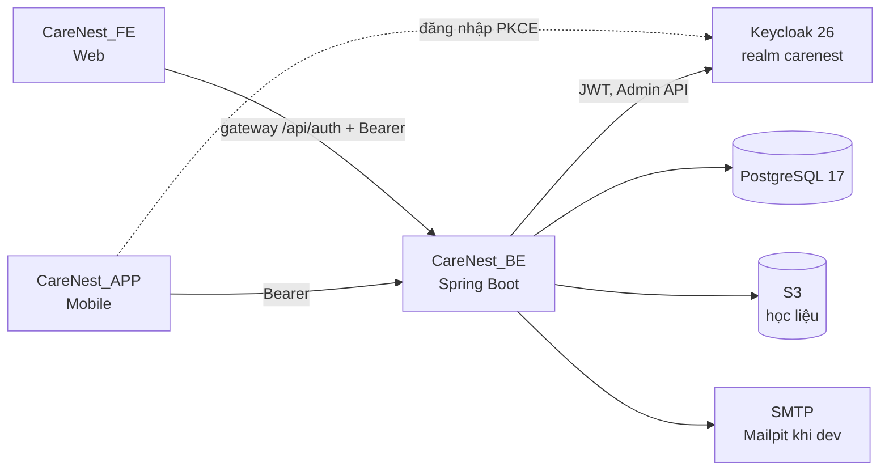

<div align="center">


# CareNest Backend

REST API, business rule và phân quyền cho hệ thống quản lý vận hành và hồ sơ trẻ của trường mầm non.


[Tài liệu](docs/INDEX.md) · [Web](https://github.com/thang-04/CareNest_FE) · [Mobile](https://github.com/thang-04/CareNest_APP)

</div>

## Giới thiệu

**CareNest** là hệ thống quản lý vận hành và hồ sơ trẻ cho trường mầm non. Thay cho việc ghi chép rời rạc trên nhiều công cụ và sổ giấy, CareNest gom các nghiệp vụ hằng ngày của nhà trường vào một hồ sơ có cấu trúc, lấy trẻ làm trung tâm:

- **Vận hành:** điểm danh, đón trẻ, chốt số suất ăn gửi bếp, thực đơn và kho, kế hoạch giáo dục, thông báo, báo cáo theo lớp, điểm trường, toàn trường.
- **Hồ sơ trẻ:** cân đo và sức khỏe, đánh giá hằng ngày, nhận xét định kỳ, khen thưởng, chia sẻ thông tin được phép cho phụ huynh.
- **AI chỉ hỗ trợ:** AI tạo bản nháp, con người duyệt; hệ thống vẫn chạy đủ khi tắt AI.

Repo này là **nguồn chuẩn (source of truth)** của toàn dự án: nghiệp vụ, domain, API contract, database và engineering memory. Hai client chỉ gọi API và không chứa business rule.

## Hệ sinh thái CareNest

| Repo | Vai trò | Người dùng |
| --- | --- | --- |
| **CareNest_BE** (repo này) | REST API, business rule, phân quyền, dữ liệu. **Nguồn chuẩn** của toàn dự án | — |
| [CareNest_FE](https://github.com/thang-04/CareNest_FE) | Web | Quản trị hệ thống, Hiệu trưởng, Phó hiệu trưởng, Giáo viên (kể cả Tổ trưởng nhóm tuổi) |
| [CareNest_APP](https://github.com/thang-04/CareNest_APP) | Mobile | Giáo viên, Nhân viên bếp, Phụ huynh |

BE quyết định nền tảng theo client của token ([ADR-0022](docs/decisions/ADR-0022-platform-access-from-token-client.md)): tài khoản Nhân viên bếp và Phụ huynh không đăng nhập được Web.

## Module

Mỗi module là một feature package xuyên các tầng; nghiệp vụ từng module ở [`docs/modules/`](docs/modules/README.md), chiều phụ thuộc ở [MODULE_MAP](docs/system/MODULE_MAP.md).

| Module | Package | Đã có |
| --- | --- | --- |
| identity-access | `account`, `security` | Gateway đăng nhập Web, OTP quên mật khẩu, tài khoản, cấp và khóa tài khoản nhân sự, phụ huynh, phân quyền cấu hình được theo vai trò và ngoại lệ |
| school-structure | `organization` | Năm học và vòng đời năm học, điểm trường, phòng, nhóm tuổi, lớp, giờ chốt, phân công giáo viên và tổ trưởng |
| child | `child` | Hồ sơ trẻ, người giám hộ và tài khoản phụ huynh, chuyển năm học, xếp lớp |
| attendance | `attendance` | Điểm danh theo lớp và ngày, mở lại ngày đã khóa, sức khỏe trong ngày |
| nutrition | `meals` | Sổ số suất: tổng hợp, xác nhận, điều chỉnh. Chưa có thực đơn, kho |
| education-plan | `eduplan` | Kế hoạch năm học và phiên bản, mục tiêu ba tầng, danh mục mục tiêu của Bộ, nhập file mục tiêu, tài liệu lớp, học liệu trên S3 |
| health, learning-observation, notification, audit, ai-assistance, reporting | — | Đã thiết kế (có module card và business rule), chưa có code |

## Tech stack

| Thành phần | Công nghệ |
| --- | --- |
| Ngôn ngữ | Java 21 (LTS) |
| Framework | Spring Boot 4.1.1: Web MVC, Validation, Data JPA, Security OAuth2 Resource Server, Actuator |
| Database | PostgreSQL 17, Flyway |
| Xác thực | Keycloak 26.8 kèm extension `carenest-auth`, Spring Security Resource Server |
| Lưu trữ file | AWS SDK v2 (S3) cho học liệu |
| API docs | springdoc-openapi 3.1.1, snapshot OpenAPI trong repo |
| Build | Maven Wrapper (`mvnw`), Lombok |
| Kiểm thử | JUnit, Spring Boot Test, Testcontainers (PostgreSQL), ArchUnit 1.5.1 |
| Format | Spotless + palantir-java-format |
| Triển khai | Docker (Temurin 21), Docker Compose, Docker Hub, Caddy, GitHub Actions |

## Kiến trúc

**Layered monolith, ranh giới theo feature** ([ADR-0001](docs/decisions/ADR-0001-modular-monolith.md)): một ứng dụng Spring Boot và một PostgreSQL, đủ cho quy mô một trường. Không microservice, không message broker.



- Luồng request: `controller → service → repository`. Entity không trả qua API; mapper chuyển Entity sang DTO.
- Mọi business rule và kiểm tra quyền nằm ở BE. Client chỉ ẩn, hiện UI theo dữ liệu BE trả về.
- Gọi dịch vụ ngoài chỉ qua `integration/` (hiện có `keycloak`, `storage`).

```text
src/main/java/com/carenest/
├── controller/<feature>/   REST endpoint, @Valid, trả ResponseJson
├── service/<feature>/      nghiệp vụ, @Transactional, kiểm tra quyền theo phạm vi
├── repository/<feature>/   Spring Data JPA
├── entity/<feature>/       JPA entity
├── dto/<feature>/          request/response DTO
├── mapper/<feature>/       Entity ↔ DTO
├── integration/            adapter dịch vụ ngoài: Keycloak, S3
├── security/               JWT, CurrentUser, policy phạm vi điểm trường/lớp/trẻ
├── config/  exception/  utils/  common/
```

### Xác thực và phân quyền

- **Web:** React gọi gateway `/api/auth/*` của BE; BE đăng nhập Keycloak bằng client confidential, trả access token trong body và giữ refresh token đã mã hóa trong cookie HttpOnly ([ADR-0013](docs/decisions/ADR-0013-react-auth-gateway.md), [ADR-0015](docs/decisions/ADR-0015-stateless-web-session-cookie.md)). Gateway bật theo môi trường.
- **Mobile:** client public dùng PKCE, gửi Bearer token.
- **Dev:** client dev chỉ hoạt động ở profile `dev`; ngoài profile này token của nó bị từ chối.
- **Phân quyền:** vai trò × quyền, giao với phạm vi trường, điểm trường, lớp, trẻ; Hiệu trưởng chỉnh được ma trận quyền và ngoại lệ theo người ([ADR-0003](docs/decisions/ADR-0003-access-scope-model.md), [ADR-0017](docs/decisions/ADR-0017-configurable-permissions.md), [ADR-0023](docs/decisions/ADR-0023-permission-scope-on-override.md)).

Cấu hình realm, lấy token, xử lý lỗi Keycloak: [KEYCLOAK](docs/system/KEYCLOAK.md); contract: [AUTH_CONTRACT](docs/contracts/AUTH_CONTRACT.md).

### Quy ước API

- Prefix chung cấu hình được (mặc định `/api`), tự gắn cho mọi controller; controller không hardcode prefix.
- Resource là danh từ số nhiều, `kebab-case`. Thao tác xác nhận, duyệt dùng endpoint hành động (`POST .../{id}/confirm`).
- Danh sách phân trang bằng `PageResponse`; ngày giờ theo ISO-8601.
- Mọi response, thành công hay lỗi, cùng một dạng; `errorCode` là mã lỗi nghiệp vụ 4 số, `null` khi thành công:

```json
{ "code": 409, "errorCode": 4007, "desc": "Điểm danh và báo ăn đã khóa sau 08:30", "data": null }
```

Chi tiết: [API_CONVENTIONS](docs/contracts/API_CONVENTIONS.md), [ERROR_CONTRACT](docs/contracts/ERROR_CONTRACT.md), mục 7, 8, 11 của [coding guide](docs/backend-coding-guide.md).

## Bắt đầu nhanh

Yêu cầu:

- Docker và Docker Compose.
- JDK 21: khi chạy API ngoài Docker và khi chạy test. Không cần cài Maven, repo có `./mvnw` (Windows: `mvnw.cmd`).
- Node.js 22: cho `scripts/verify.mjs`, git hook và các script Keycloak.

```bash
git clone https://github.com/thang-04/CareNest_BE.git
cd CareNest_BE
cp .env.example .env    # bắt buộc; đổi các giá trị change-me khi lên server
docker compose up --build
```

Compose dựng PostgreSQL, Keycloak (import realm `carenest`), Mailpit và API với profile `dev` (nạp dữ liệu mẫu). Swagger UI: <http://localhost:8080/swagger-ui/index.html>.

User dev (8 tài khoản, bảng ở `docs/system/KEYCLOAK.md` mục 5) dùng mật khẩu `demo123` **chỉ ở máy local**. VPS demo dùng cùng user nhưng mật khẩu là `KEYCLOAK_DEV_USER_PASSWORD` trong `.env` của VPS (`docs/system/DEPLOYMENT.md`).

Chạy API trong IDE để debug, chỉ để hạ tầng trong Docker:

```bash
docker compose up -d postgres keycloak mailpit
./mvnw spring-boot:run -Dspring-boot.run.profiles=dev
```

Profile `dev` tự đọc `.env` ở thư mục gốc. Tài khoản dev, cách lấy token và gọi API: [KEYCLOAK](docs/system/KEYCLOAK.md); Postman: [`docs/api/`](docs/api/CareNest.postman_collection.json). Bật gateway đăng nhập Web ở máy local: [`docker/keycloak/auth/README.md`](docker/keycloak/auth/README.md).

Schema chỉ đổi qua Flyway migration trong `src/main/resources/db/migration`; migration đã commit thì không sửa, tạo migration mới.

## Kiểm thử và cổng chất lượng

| Lệnh | Việc |
| --- | --- |
| `node scripts/verify.mjs` | **Cổng bắt buộc trước khi báo xong hoặc mở PR**: `mvnw verify` gồm test, ArchUnit, snapshot OpenAPI, Spotless; tự bật git hook, log ở `target/verify.log` |
| `node scripts/verify.mjs --quick` | Thay đổi nhỏ: test liên quan file đã đổi, ArchUnit, Spotless |
| `./mvnw test` | Chỉ chạy test |

- Test tích hợp dùng PostgreSQL thật qua Testcontainers nên cần Docker đang chạy.
- Spotless so với `origin/main`, cần có ref này ở máy (`git fetch origin main`).
- Các nhóm test bắt buộc: phân quyền theo phạm vi (`security/authorization`), format response (`ResponseContractTest`), kiến trúc (`ArchitectureRulesTest`), snapshot OpenAPI (`OpenApiSnapshotTest`).

Chiến lược test: [TEST_STRATEGY](docs/quality/TEST_STRATEGY.md); tiêu chí hoàn thành: [DEFINITION_OF_DONE](docs/quality/DEFINITION_OF_DONE.md).

## Triển khai

Workflow [`deploy.yml`](.github/workflows/deploy.yml) chỉ chạy trên `main`, bỏ qua thay đổi chỉ có tài liệu:

- Image gắn tag theo hash nội dung; image đã có trên Docker Hub thì bỏ qua bước build.
- PR vào `main`: verify API, build và test extension Keycloak.
- Push vào `main`: thêm bước đẩy image lên Docker Hub, đồng bộ lên VPS, `docker compose up`, reload Caddy, kiểm tra HTTPS.

Trên VPS mọi service chỉ nghe localhost; Caddy phục vụ `auth.carenest.edu.vn` (Keycloak) và chuyển `/api/*` của `web.carenest.edu.vn` vào API. Cài đặt, cổng, rollback: [DEPLOYMENT](docs/system/DEPLOYMENT.md).

## Cấu trúc repo

```text
CareNest_BE/
├── src/                      source và test
├── docs/                     nghiệp vụ, kiến trúc, contract, database, ADR, engineering memory
├── specs/                    spec theo tính năng của kế hoạch giáo dục
├── scripts/                  verify, check-ai-layer
├── docker/                   Keycloak (realm, extension, gateway), PostgreSQL
├── deploy/                   site Caddy, mẫu env cho VPS
├── .github/workflows/        CI/CD
├── .githooks/                commit-msg, pre-commit, pre-push
├── Dockerfile                build multi-stage, runtime chạy bằng user không phải root
├── compose.yaml              hạ tầng + API cho dev
├── compose.auth.yaml         overlay bật gateway đăng nhập Web
├── compose.vps.yaml          stack trên VPS
├── .env.example              mẫu cấu hình
└── AGENTS.md, CLAUDE.md, .ai/, .claude/, .agents/   hướng dẫn cho AI agent
```

## Tài liệu

| Cần | Đọc |
| --- | --- |
| Quy tắc code (**đọc trước khi code**) | [backend-coding-guide](docs/backend-coding-guide.md) |
| Mục lục toàn bộ tài liệu | [docs/INDEX.md](docs/INDEX.md) |
| Bối cảnh, phạm vi V1, ngoài phạm vi | [PROJECT_CONTEXT](docs/context/PROJECT_CONTEXT.md) |
| Đã làm, chưa làm | [CURRENT_STATE](docs/context/CURRENT_STATE.md) |
| Thuật ngữ tiếng Việt và tên trong code | [GLOSSARY](docs/context/GLOSSARY.md) |
| Business rule (có ID, trạng thái, nguồn) | [BUSINESS_RULES](docs/business/BUSINESS_RULES.md) |
| Vai trò và phân quyền | [USER_ROLES](docs/business/USER_ROLES.md) |
| Nghiệp vụ theo module | [docs/modules](docs/modules/README.md) |
| Kiến trúc hệ thống | [SYSTEM_ARCHITECTURE](docs/system/SYSTEM_ARCHITECTURE.md) |
| Quyết định kiến trúc (ADR) | [docs/decisions](docs/decisions/) |
| Database | [DATABASE](docs/database/DATABASE.md) |
| Lỗi đã gặp | [ISSUE_INDEX](docs/knowledge/ISSUE_INDEX.md), [TROUBLESHOOTING](docs/knowledge/TROUBLESHOOTING.md) |

## Quy ước đóng góp

- **Nhánh:** `main` là bản phát hành đã duyệt, `dev` để tích hợp, `release/*` để kiểm thử bản phát hành. Nhánh làm việc tạo từ `dev`, đặt tên `<feature|fix>/<mã-jira>-<mã-công-việc>-<tên-luồng>`, ví dụ `fix/G94-190-BE-FIX-03-meal-count-validation`.
- **Commit:** `<mã-jira>: <mô tả tiếng Anh>`, cả dòng tối đa 72 ký tự, mỗi commit một thay đổi logic, không ghi tên công cụ AI.
- **Pull request:** gộp vào `dev`; chỉ `release/*` được gộp vào `main`. Cần ít nhất một thành viên khác duyệt và mọi kiểm tra bắt buộc đạt.
- **Git hook** (`.githooks/`, bật tự động khi chạy `node scripts/verify.mjs`): chặn commit sai định dạng, file secret, sửa migration đã commit, push thẳng lên `main` và force push.
- **Không commit** secret hay dữ liệu trẻ thật; repo chỉ chứa mẫu cấu hình (`.env.example`).
- **Trao đổi với team trước khi:** thêm hoặc nâng dependency, đổi API contract (kèm tác động tới FE, APP), thêm hạ tầng mới.

Chi tiết: [AGENTS.md](AGENTS.md), mục "Quy tắc chung CareNest".

## Trạng thái

- **Đã có:** 9 package feature có code (`controller/` của `src/main/java/com/carenest`), migration Flyway trong `src/main/resources/db/migration`, gateway đăng nhập Web, phân quyền cấu hình được, học liệu S3, triển khai VPS qua CI.
- **Chưa có:** sức khỏe định kỳ, đánh giá trẻ, thông báo, audit, AI, báo cáo; thực đơn và kho của module dinh dưỡng.

Chi tiết từng module và các rule còn `PENDING`: [CURRENT_STATE](docs/context/CURRENT_STATE.md).
