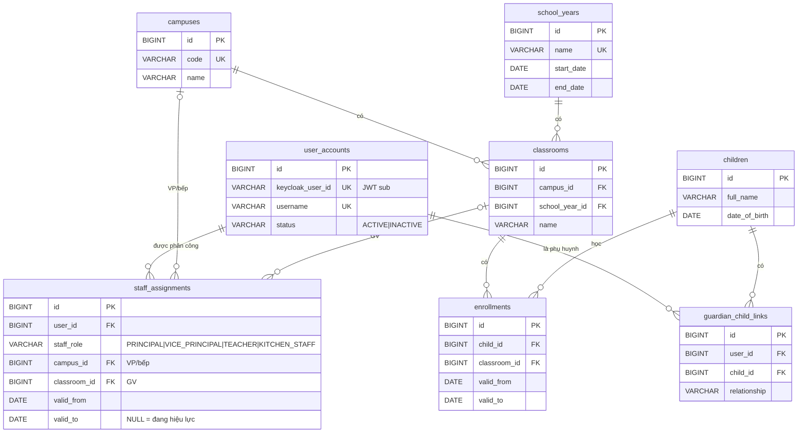
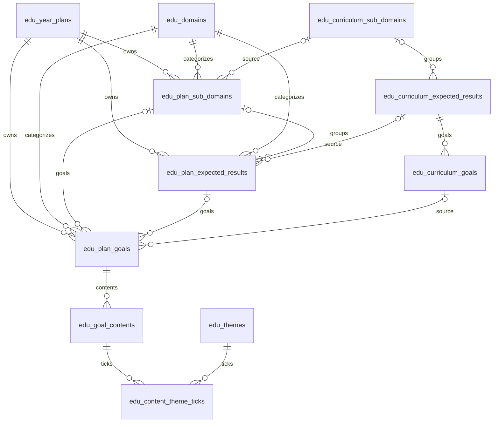
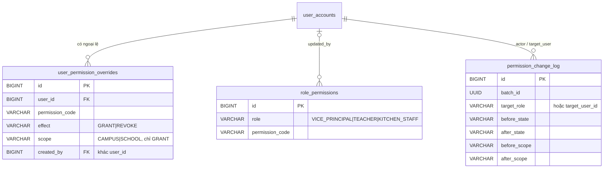

# ERD

> Status: **ĐANG ĐIỀN** — cập nhật cùng thay đổi với migration. Chi tiết cột: `DATA_DICTIONARY.md`. Mô hình khái niệm đầy đủ: `docs/business/DOMAIN_MODEL.md`.

## identity-access, school-structure, child (V1–V3)

## education-plan — Ba bảng mục tiêu (V35)

Ba bảng có ID từ sequence chung; FK cha ghép với year_plan_id/domain_id. FK goal→group kiểm sub_domain_key để sub của goal và group khớp kể cả NULL. Cấp cha tùy chọn theo user 29/10/2026; không đổi rows/kind API. Chi tiết: [ADR-0021](../decisions/ADR-0021-year-plan-goal-hierarchy.md).

## identity-access — phân quyền (V7, ADR-0017)

