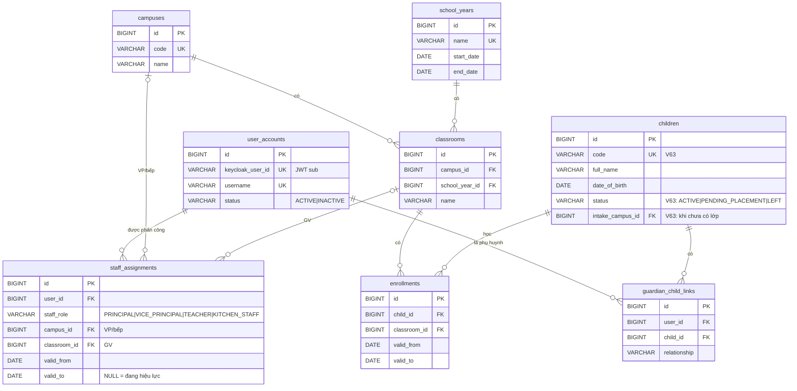
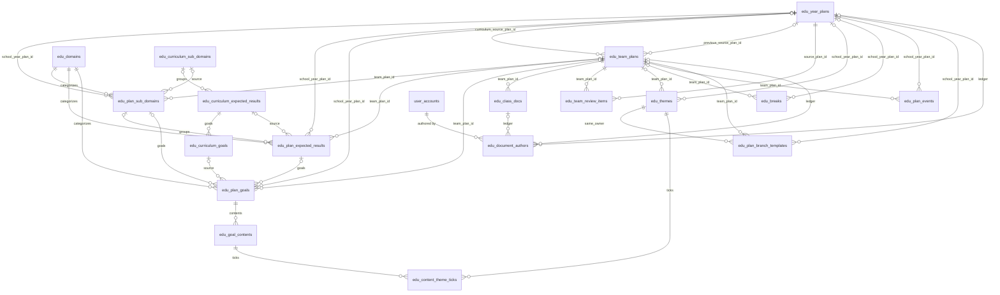
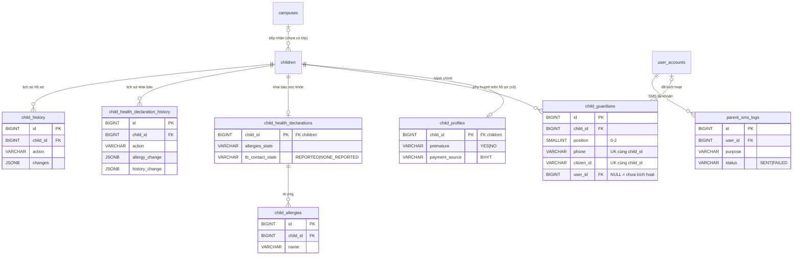
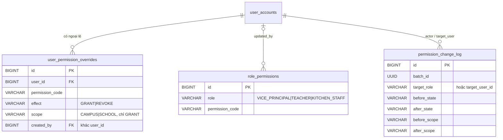

# ERD

> Status: **ĐANG ĐIỀN** — cập nhật cùng thay đổi với migration. Chi tiết cột: `DATA_DICTIONARY.md`. Mô hình khái niệm đầy đủ: `docs/business/DOMAIN_MODEL.md`.

## identity-access, school-structure, child (V1–V3)

## education-plan — năm/tổ và cây mục tiêu (V35, V89/V90 candidate)

Schema đích V90 chỉ kiểm trên scratch; chưa áp dụng DB đang dùng. Header năm/tổ có ID từ `edu_plan_id_seq` chung, self-source trong từng bảng, không cột plan_level. Ba bảng cây dùng `edu_plan_rows_seq`; FK cha ghép với mỗi school_year_plan_id/team_plan_id và domain_id, giữ deferred semantics. FK goal→group kiểm sub_domain_key để sub của goal và group khớp kể cả NULL. Cấp cha tùy chọn theo user 29/10/2026; không đổi rows/kind API. Chi tiết: [ADR-0021](../decisions/ADR-0021-year-plan-goal-hierarchy.md).
Sổ cái `edu_document_authors` (V80, V81) theo dõi người soạn thực tế qua đúng một FK giữa `edu_year_plans`, `edu_team_plans` và `edu_class_docs` để ngăn tự duyệt (EDU-54).
## child — tiếp nhận trẻ, phụ huynh trên hồ sơ, khai báo sức khỏe (V63)

`child_code_sequences` (số thứ tự mã trẻ theo năm) không có quan hệ.

## identity-access — phân quyền (V7, ADR-0017)

