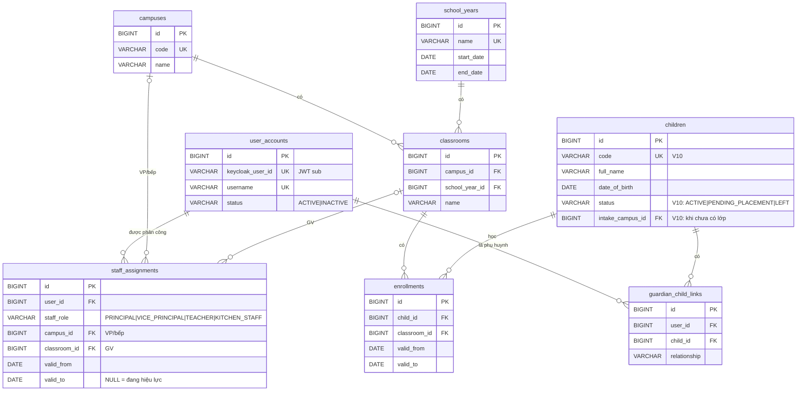
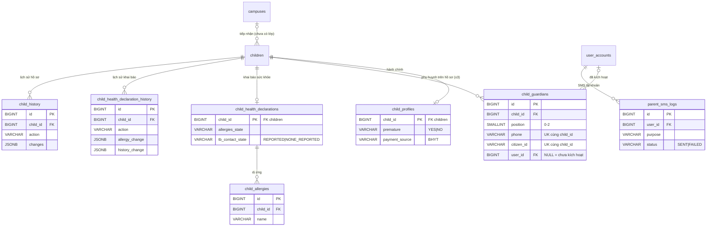
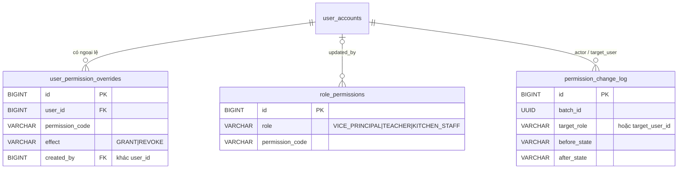

# ERD

> Status: **ĐANG ĐIỀN** — cập nhật cùng thay đổi với migration. Chi tiết cột: `DATA_DICTIONARY.md`. Mô hình khái niệm đầy đủ: `docs/business/DOMAIN_MODEL.md`.

## identity-access, school-structure, child (V1–V3)

## child — tiếp nhận trẻ, phụ huynh trên hồ sơ, khai báo sức khỏe (V10)

`child_code_sequences` (số thứ tự mã trẻ theo năm) không có quan hệ.

## identity-access — phân quyền (V7, ADR-0017)

