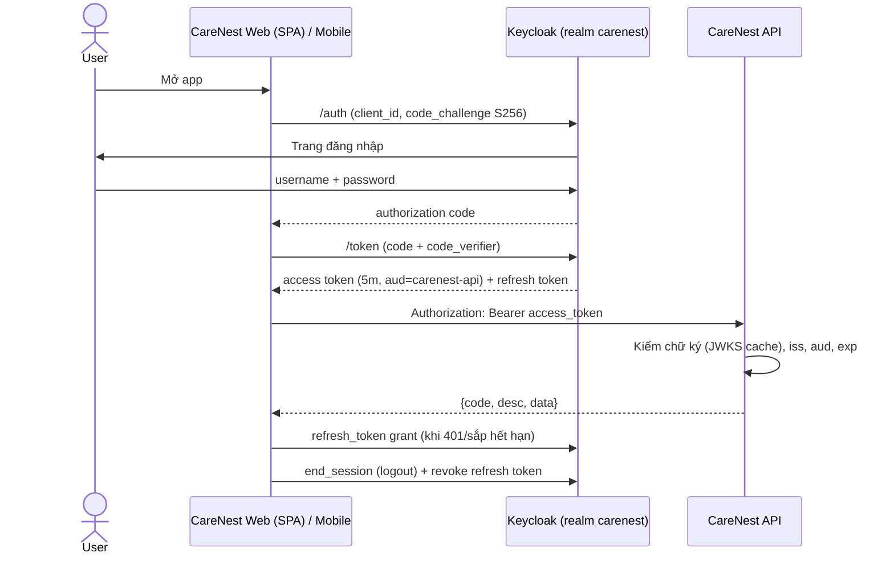
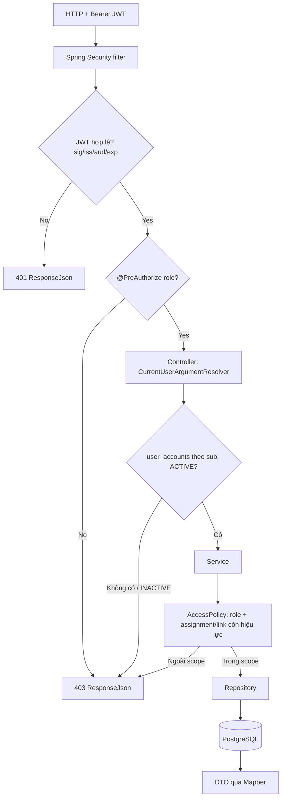

# CareNest BE — Keycloak + Spring Security Resource Server + Domain Authorization

## Context

Mục 15 bước 2 của guide là "Đăng nhập và phạm vi": user/role, phân công campus/lớp, liên kết phụ huynh–trẻ và test quyền. Bước này đang bị chặn vì auth chưa chốt. User xác nhận **nhóm đã chốt Keycloak**. Cấu trúc được chốt là: Keycloak lo xác thực và danh tính; Spring Security làm OAuth2 Resource Server để kiểm tra JWT và role; CareNest service/policy kiểm tra phạm vi dữ liệu (campus/lớp/trẻ). Đây là quyết định mới, đảo định hướng cũ "không dùng Keycloak trong v1" ở guide §2, nên phải có ADR-0011 và sửa guide/rule trước khi viết code.

User đã quyết:
1. Keycloak đã chốt: triển khai.
2. Mật khẩu ban đầu dùng **cả hai cách**. Mặc định Admin nhập mật khẩu tạm (`temporary=true`). Nếu user có email và SMTP đã bật thì gửi thêm email `UPDATE_PASSWORD`.
3. Làm **Phase 2–9**, **dừng sau mỗi phase** để user review.

---

## 1. Kiến trúc CareNest hiện tại (Phase 0)

- Java 21, Spring Boot **4.1.1** (Spring Security trong BOM là **7.1.1**), Jackson 3 (`tools.jackson.databind`), Maven `mvnw`, PostgreSQL 17, Flyway, springdoc 3.1.1, Testcontainers.
- Kiến trúc layered monolith (ADR-0001): `controller/ service/ repository/ entity/ dto/ mapper/ integration/ security/ config/ exception/ utils/ common/`. Mỗi package chia sub-package theo feature (`account`, `organization`, `child`…). Các package lớp hiện **trống**, chỉ có `package-info.java`.
- Response chuẩn `ResponseJson {code, desc, data}` với `code` = HTTP status lấy từ `ApiCode` (không có mã riêng). `GlobalException(ApiCode, desc)` và `GlobalExceptionHandler` có sẵn. Test hợp đồng response ở `ResponseContractTest` (@WebMvcTest).
- Prefix API cấu hình qua `carenest.api.prefix`, gắn trong `WebMvcConfig`; controller không được ghi prefix.
- `db/migration` trống, chưa có entity nào. `compose.yaml` mới có postgres + api. `.env.example` mới có biến DB.
- FE (Next.js, PROPOSED) và APP (React Native, PROPOSED): **chưa có code**. `AUTH_FLOW.md` hai bên đều là SKELETON.
- Working tree đang có thay đổi của user ở `ResponseJson.java` (bỏ Javadoc). **Không đụng vào.**

## 2. Auth/Security hiện có

**Không có gì cả.** Chưa có dependency security, `SecurityConfig`, JwtService, UserDetailsService, cột password, bảng refresh_token hay role enum. Vì vậy **không có code cũ phải migrate hoặc xóa** (prompt mục 79 không áp dụng).

Docs liên quan cần cập nhật: guide §2/§5/§8.5/§9/§11; `docs/architecture/SECURITY.md`; `docs/contracts/AUTH_CONTRACT.md` (SKELETON); `.claude/rules/security.md` (đang cấm thêm Spring Security); các card `identity-access`, `school-structure`, `child`; ADR-0003 (mô hình scope, ACCEPTED, giữ nguyên).

## 3. Gap analysis

| Hạng mục | Hiện tại | Đích |
| --- | --- | --- |
| Xác thực | Không có | Keycloak (Auth Code + PKCE); BE chỉ làm Resource Server |
| Kiểm tra JWT | Không có | `NimbusJwtDecoder` dùng JWKS (local, cache, xoay key) + validator kiểm issuer, `aud=carenest-api`, exp/nbf |
| Role | Không có | `realm_access.roles` → `ROLE_*` qua `JwtAuthenticationConverter` của Spring + converter role Keycloak |
| Lỗi 401/403 | Chưa có handler | EntryPoint/AccessDeniedHandler ghi `ResponseJson` (guide 8.5); `AccessDeniedException` từ `@PreAuthorize` → 403 trong `GlobalExceptionHandler` |
| User nghiệp vụ | Không có | Bảng `user_accounts.keycloak_user_id` = JWT `sub`; kiểm tra `status` mỗi request |
| Scope | Chỉ có trong docs | `staff_assignments`, `enrollments`, `guardian_child_links` + 3 policy |
| Cấp tài khoản | Không có | `AccountProvisioningService` → `integration/keycloak` (RestClient) + bù trừ khi lỗi |
| Hạ tầng dev | postgres + api | thêm keycloak (realm import), mailpit, DB `keycloak` riêng |

### Chỗ prompt khác convention của repo (giữ convention repo, không vi phạm kiến trúc bảo mật)

| Prompt | Convention repo | Chọn |
| --- | --- | --- |
| Tách bảng `teacher_assignments`, `vice_principal_assignments`, `kitchen_assignments`, `parent_children` | DOMAIN_MODEL: `StaffAssignment` chung + `GuardianChildLink` | `staff_assignments(staff_role, campus_id, classroom_id, valid_from, valid_to)` + `guardian_child_links`. Cần `staff_role` vì một campus assignment có thể là của VP hoặc của bếp |
| Service tự gọi `currentUserService.getCurrentUser()` | Guide §5: controller lấy `CurrentUser` rồi truyền vào service | `CurrentUserArgumentResolver` resolve tham số `CurrentUser` ở controller, service nhận `CurrentUser` |
| Policy inject repository | MODULE_MAP: `security/` đọc **service** của organization/child | Policy gọi `StaffAssignmentService`, `ClassroomService`, `EnrollmentService`, `GuardianChildLinkService`. Các service này không gọi ngược policy |
| Body lỗi `{timestamp,status,code,message,path}`, mã `ACCOUNT_NOT_PROVISIONED` | `ResponseJson`, `code`=HTTP, phân biệt lỗi bằng `desc` | `403 "Account is not provisioned"`, `403 "Account is inactive"` |
| `ResourceNotFoundException` | `GlobalException(ApiCode.NOT_FOUND, …)` | Theo repo |
| Bảng `users` / `UserRepository` | DOMAIN_MODEL: `UserAccount` | `user_accounts` / `UserAccount` / `UserAccountRepository` (tránh trùng tên `User` của Spring Security) |
| Keycloak Admin SDK | Boot 4 dùng Jackson 3; `keycloak-admin-client` kéo Jackson 2 + RESTEasy | `RestClient` gọi Admin REST API, không thêm dependency |
| `/api/children/{id}` | Prefix lấy từ cấu hình | `@RequestMapping("/children")` |
| Principal chỉ cần role | USER_ROLES: Principal cần `StaffAssignment(scope=SCHOOL)` | Cần cả role PRINCIPAL lẫn assignment PRINCIPAL còn hiệu lực |

## 4. Kiến trúc đề xuất

Policy kết hợp hai điều kiện: **role trong token** VÀ **assignment/link còn hiệu lực trong DB**. Ngày hiện tại lấy từ `Clock` bean (Asia/Ho_Chi_Minh).

- `CampusAccessPolicy.canViewCampus`: (PRINCIPAL + assignment PRINCIPAL active) hoặc (VICE_PRINCIPAL + assignment VP active tại campus đó). Kitchen **không** được.
- `ClassroomAccessPolicy.canViewClassroom`: (TEACHER + assignment active tại lớp đó) hoặc `canViewCampus(campus của lớp)`.
- `ChildAccessPolicy.canViewChild`: (PARENT + có link) hoặc `canViewClassroom(lớp có enrollment active hôm nay)`.
- Mỗi method có cặp `checkCanXxx`, khi từ chối ném `GlobalException(FORBIDDEN, …)` và log warn kèm id.
- ADMIN **không bypass** scope (AUTH-06/P-16 default-deny).
- Quyền xem lịch sử (lớp năm cũ) chưa có rule nên **từ chối**. Logic này gói trong policy để sau dễ đổi.
- **403 vs 404:** chạy policy **trước** khi load resource. Nên id ngoài scope và id không tồn tại đều trả `403` cùng `desc`, không lộ thông tin để dò id. Vẫn giữ đúng ERROR_CONTRACT (ngoài scope → FORBIDDEN).
- Bảo mật endpoint: permitAll chỉ cho `/actuator/health`, `/swagger-ui/**`, `/swagger-ui.html`, `/v3/api-docs/**`, `/error`. Mọi request khác `authenticated()` (mặc định chặn). Role kiểm bằng `@PreAuthorize` trên từng controller method. Có test reflection bắt buộc mọi handler trong `com.carenest.controller..` phải có `@PreAuthorize`.
- Stateless; tắt CSRF, formLogin, httpBasic. **Lý do tắt CSRF:** API chỉ xác thực bằng header `Authorization: Bearer`, không có cookie hay session, mà trình duyệt không tự gắn header này khi request cross-site. Nếu sau này FE chuyển sang BFF/cookie thì phải bật lại.
- CORS: danh sách origin lấy từ `CARENEST_CORS_ALLOWED_ORIGINS`, không dùng `*`, `allowCredentials=false`. App native không cần CORS.
- Không gọi Keycloak ở mỗi request: JWKS được fetch lazy rồi cache. App khởi động được khi Keycloak đang tắt. Token đã cấp vẫn dùng được miễn JWKS còn trong cache.

### Luồng đăng nhập



### Luồng phân quyền



### Luồng cấp tài khoản (có bù trừ)

```mermaid
sequenceDiagram
    actor Admin
    participant API as AccountController
    participant S as AccountProvisioningService
    participant KC as Keycloak Admin API
    participant DB as PostgreSQL
    Admin->>API: POST /accounts (role, username, fullName, email?, temporaryPassword?)
    API->>S: createAccount(currentUser, request)
    S->>DB: username đã tồn tại? (409)
    S->>KC: create user (enabled, UPDATE_PASSWORD, temp credential nếu có)
    KC-->>S: keycloakUserId (Location)
    S->>KC: map realm role
    S->>DB: saveAndFlush user_accounts
    alt Lỗi gán role hoặc lỗi DB
        S->>KC: delete user (bù trừ; nếu xóa thất bại thì log ERROR kèm keycloakUserId để dọn tay)
        S-->>API: GlobalException (409/503)
    end
    opt có email và actions-email bật
        S->>KC: execute-actions-email [UPDATE_PASSWORD] (lỗi thì chỉ log warn, không rollback)
    end
    API-->>Admin: 201 AccountResponse
```

**Vô hiệu hóa tài khoản:** cập nhật DB `status=INACTIVE` trước. Ngay request sau, CareNest đã chặn (403) dù token còn hạn. Sau đó gọi Keycloak `enabled=false` và `logout` (thu hồi session/refresh token). Nếu bước Keycloak lỗi thì trả 503 "đã lưu, cần thử lại"; thao tác idempotent nên gọi lại được.

## 5. File tạo mới (base `src/main/java/com/carenest/`)

- `config/SecurityConfig.java`: filter chain, `JwtDecoder` + `static jwtValidator(issuer, audience)` (để test được), `JwtAuthenticationConverter`, CORS source, `@EnableMethodSecurity`.
- `config/ClockConfig.java`: `Clock` bean, zone lấy từ `carenest.time-zone`.
- `security/`: `CareNestRole` (enum 6 role), `KeycloakRealmRoleConverter`, `RestAuthenticationEntryPoint`, `RestAccessDeniedHandler`, `SecurityResponseWriter` (theo mẫu guide 8.5), `CurrentUser` (record: userId, keycloakUserId, username, fullName, email, `Set<CareNestRole>` roles, `hasRole`), `CurrentUserService`, `CurrentUserArgumentResolver`.
- `security/authorization/`: `CampusAccessPolicy`, `ClassroomAccessPolicy`, `ChildAccessPolicy`. **Không** tạo Attendance/Health/Nutrition policy vì module chưa có (YAGNI).
- `entity/account/`: `UserAccount`, `UserStatus`. `entity/organization/`: `Campus`, `SchoolYear`, `Classroom`, `StaffAssignment`. `entity/child/`: `Child`, `Enrollment`, `GuardianChildLink`. Tham chiếu xuyên feature dùng `Long` id.
- `repository/account/UserAccountRepository`. `repository/organization/`: `ClassroomRepository`, `StaffAssignmentRepository` (query `exists…Active…(…, date)`). `repository/child/`: `ChildRepository`, `EnrollmentRepository` (`findActiveClassroomId`), `GuardianChildLinkRepository`.
- `service/organization/`: `StaffAssignmentService`, `ClassroomService`. `service/child/`: `ChildService`, `EnrollmentService`, `GuardianChildLinkService`. `service/account/`: `AccountService` (`getMyAccount`), `AccountProvisioningService`.
- `controller/account/AccountController`: `GET /accounts/me` (mọi user đã xác thực), `POST /accounts` (ADMIN), `PATCH /accounts/{userId}/status` (ADMIN). `controller/child/ChildController`: `GET /children/{childId}` (TEACHER, VICE_PRINCIPAL, PRINCIPAL, PARENT).
- `dto/account/`: `MyAccountResponse`, `StaffAssignmentSummaryResponse`, `CreateAccountRequest`, `UpdateAccountStatusRequest`, `AccountResponse`. `dto/child/ChildProfileResponse`. `mapper/account/AccountMapper`, `mapper/child/ChildMapper` (mapper viết tay).
- `integration/keycloak/`: `IdentityProviderClient` (interface, đúng convention interface + adapter của integration), `KeycloakIdentityProviderClient` (RestClient; token client_credentials cache tới `expires_in − 30s`; timeout connect 3s / read 5s; **không log body**), `KeycloakProperties` (`@ConfigurationProperties("carenest.keycloak")`), `IdentityProviderException` (CONFLICT | UNAVAILABLE).
- Resources: `db/migration/V1__create_user_accounts.sql`, `V2__create_school_structure.sql`, `V3__create_children.sql`; `db/dev/R__dev_seed.sql` (repeatable, idempotent theo natural key, dữ liệu giả); `application-dev.yml` (thêm `classpath:db/dev` vào location Flyway).
- Docker: `docker/keycloak/import/carenest-realm.json`, `docker/keycloak/dev/carenest-users-0.json` (user dev, id cố định, password lấy từ `${KEYCLOAK_DEV_USER_PASSWORD}`; nếu KC 26 không import được file users tách riêng thì gộp vào file realm dev), `docker/postgres/init/01-create-keycloak-db.sh`.
- Tests (`src/test/java/com/carenest/`): `security/KeycloakRealmRoleConverterTest`, `config/JwtValidatorTest` (token RSA ký local: hợp lệ / hết hạn / sai iss / sai aud / sai chữ ký), `config/SecurityConfigTest` (public / 401 / 403 / CORS), `security/CurrentUserServiceTest`, `security/authorization/*PolicyTest`, `service/child/ChildServiceTest`, `controller/child/ChildControllerTest` (ma trận role), `controller/ControllerSecurityCoverageTest`, `service/account/AccountProvisioningServiceTest`, `integration/keycloak/KeycloakIdentityProviderClientTest` (MockRestServiceServer), `repository/ScopeQueryIntegrationTest` (Testcontainers: query theo ngày, assignment hết hạn).
- Docs: `docs/decisions/ADR-0011-keycloak-authentication.md`; **`docs/system/KEYCLOAK.md`** là hướng dẫn sử dụng và cấu hình Keycloak cho team (nội dung ở mục 13), link từ README, `docs/INDEX.md`, `docs/system/DEPLOYMENT.md`. Lưu bản copy plan vào `docs/plans/active/2026-10-04-keycloak-auth.md`.

## 6. File sửa

- `pom.xml`: thêm `spring-boot-starter-security-oauth2-resource-server`, test `spring-boot-starter-security-oauth2-resource-server-test` (đã xác nhận có trong BOM 4.1.1). Không thêm gì khác.
- `src/main/resources/application.yml`: `carenest.security.jwt.{issuer-uri, jwk-set-uri, audience}`, `carenest.security.cors.allowed-origins`, `carenest.keycloak.*`, `carenest.time-zone`.
- `config/WebMvcConfig.java`: đăng ký `CurrentUserArgumentResolver`. `config/OpenApiConfig.java`: thêm security scheme `bearerAuth` (HTTP bearer JWT) dùng chung, bỏ comment "chưa chốt auth".
- `exception/GlobalExceptionHandler.java`: `AccessDeniedException` → 403, `AuthenticationException` → 401.
- `src/test/.../ResponseContractTest.java` + `controller/ResponseContractTestController.java`: thêm `.with(jwt())`, test shape 401/403.
- `compose.yaml`: services `keycloak` (pin `quay.io/keycloak/keycloak:26.x`, `start-dev --import-realm`, port 8180, `KC_HOSTNAME=http://localhost:8180`, `KC_HOSTNAME_BACKCHANNEL_DYNAMIC=true`, DB postgres `keycloak`, health enabled) và `mailpit` (8025/1025); mount init script vào postgres; env cho api (`SPRING_PROFILES_ACTIVE=dev`, `KEYCLOAK_*`). API **không** `depends_on` keycloak.
- `.env.example`: tên biến, không có secret.
- Docs: guide §2/§5/§8.5/§9/§11; `.claude/rules/security.md`; `docs/architecture/SECURITY.md` (thêm 3 diagram, logout/refresh, trade-off); `docs/contracts/AUTH_CONTRACT.md`; `docs/contracts/ERROR_CONTRACT.md` (desc 401/403); `docs/architecture/PACKAGE_STRUCTURE.md`; cards `identity-access`, `school-structure`, `child`; `docs/business/DOMAIN_MODEL.md` (shape StaffAssignment); `docs/database/{DATABASE,DATA_DICTIONARY,ERD}.md`; `docs/context/CURRENT_STATE.md`; `README.md`.

## 7. File có thể xóa sau

Không có. Repo chưa có auth cũ.

## 8. Thay đổi database

Đây là migration đầu tiên nên nó **đặt convention** (ghi lại vào DATABASE.md): `BIGINT GENERATED ALWAYS AS IDENTITY`, `TIMESTAMPTZ created_at/updated_at DEFAULT now()`, enum lưu bằng `VARCHAR` + `CHECK`, không có tiền tố bảng.

- **V1 `user_accounts`**: id, `keycloak_user_id VARCHAR(36) NOT NULL UNIQUE`, `username VARCHAR(100) NOT NULL UNIQUE`, email NULL, `full_name NOT NULL`, `status CHECK (ACTIVE, INACTIVE)`, timestamps. **Không có cột password hay role.**
- **V2**: `campuses`(code UNIQUE, name); `school_years`(name UNIQUE, start_date, end_date CHECK); `classrooms`(campus_id FK, school_year_id FK, name, UNIQUE(school_year_id, campus_id, name), idx campus_id); `staff_assignments`(user_id FK, `staff_role CHECK (PRINCIPAL, VICE_PRINCIPAL, TEACHER, KITCHEN_STAFF)`, campus_id FK NULL, classroom_id FK NULL, valid_from, valid_to NULL). Ràng buộc CHECK shape: PRINCIPAL thì cả hai FK null; VP/KITCHEN thì có campus; TEACHER thì có classroom. CHECK `valid_to >= valid_from`. Index user_id, campus_id, classroom_id.
- **V3**: `children`(full_name, date_of_birth, timestamps); `enrollments`(child_id FK, classroom_id FK, valid_from, valid_to NULL, idx child_id/classroom_id); `guardian_child_links`(user_id FK, child_id FK, relationship, created_at, UNIQUE(user_id, child_id), idx child_id).
- Đây là bảng **khung tối thiểu cho scope**. Cột nghiệp vụ thêm sau bằng migration mới khi làm module organization/child.

## 9. Cấu hình Keycloak (realm import dev)

- Realm `carenest` (1 realm). Realm roles: ADMIN, PRINCIPAL, VICE_PRINCIPAL, TEACHER, KITCHEN_STAFF, PARENT. **Không** có role theo lớp/campus. **Không** dùng Authorization Services.
- Client scope `carenest-api-audience`: audience mapper với `included.custom.audience=carenest-api`, gắn vào access token. Đặt làm default scope cho web/mobile/dev. Nhờ vậy **không cần** client `carenest-api` riêng; ID token và refresh token bị từ chối vì sai `aud`.
- Clients:
  - `carenest-web`: public, standard flow, PKCE S256, redirect `${CARENEST_WEB_ORIGIN}/*`, web origins `${CARENEST_WEB_ORIGIN}`. Nếu FE chọn BFF thì đổi sang confidential; BE không bị ảnh hưởng.
  - `carenest-mobile`: public, PKCE S256, redirect `${CARENEST_MOBILE_REDIRECT_URI}` (mặc định `carenest://oauth/callback`, APP chốt sau), không có web origins.
  - `carenest-backend`: confidential, **chỉ service account**, secret `${KEYCLOAK_ADMIN_CLIENT_SECRET}`, realm-management roles `manage-users`, `view-users`, `query-users`. Nếu GET role trả 403 thì thêm `view-realm` (kiểm ở Phase 7).
  - `carenest-dev` (**chỉ dev**): public, bật direct access grant để lấy token bằng curl/Swagger. Prod không được có client này.
- Realm settings (PROPOSED, có ghi lý do): access token 5 phút, SSO idle 30 phút / max 10 giờ, xoay refresh token (`revokeRefreshToken=true`), brute-force bật với `failureFactor=5` (SECURITY.md yêu cầu khóa tạm), password policy `length(8) and notUsername`, tắt tự đăng ký, `editUsernameAllowed=false`, SMTP → mailpit. Mobile có cần `offline_access` không là việc APP quyết.
- User dev (id cố định, khớp seed): `admin.dev`, `principal.dev`, `viceprincipal.a` (Campus A), `teacher.a` (lớp A1), `teacher.b` (lớp B1 + một assignment cũ ở A1 đã hết hạn), `parent.a` (trẻ lớp A1), `parent.b` (trẻ lớp B1), `kitchen.a` (Campus A).
- Bootstrap admin của Keycloak lấy từ `KC_BOOTSTRAP_ADMIN_USERNAME/PASSWORD` trong `.env`. Keycloak dùng DB `keycloak` + user riêng trên **cùng container postgres**: đơn giản, ít container, vẫn tách quyền.

**Biến môi trường mới:** `KEYCLOAK_ISSUER_URI`, `KEYCLOAK_JWK_SET_URI`, `KEYCLOAK_AUDIENCE`, `KEYCLOAK_BASE_URL`, `KEYCLOAK_REALM`, `KEYCLOAK_ADMIN_CLIENT_ID`, `KEYCLOAK_ADMIN_CLIENT_SECRET`, `KEYCLOAK_ACTIONS_EMAIL_ENABLED`, `CARENEST_CORS_ALLOWED_ORIGINS`, `KC_BOOTSTRAP_ADMIN_USERNAME`, `KC_BOOTSTRAP_ADMIN_PASSWORD`, `KEYCLOAK_DB_PASSWORD`, `KEYCLOAK_PORT`, `KEYCLOAK_DEV_USER_PASSWORD`, `CARENEST_WEB_ORIGIN`, `CARENEST_MOBILE_REDIRECT_URI`.

## 10. Các phase (mỗi phase: test → checklist guide §17 → báo cáo → **dừng chờ user OK**; không commit trừ khi user yêu cầu, khi commit thì hỏi Jira key)

1. **Phase 2 — Quyết định + nền Resource Server + hạ tầng dev.** Viết ADR-0011, sửa guide §2, `.claude/rules/security.md`, bản nháp AUTH_CONTRACT. Thêm dependency vào pom. Làm SecurityConfig, converter, các handler, map exception, OpenAPI bearer, cấu hình yml/env. Compose thêm keycloak + mailpit + DB keycloak + realm import (chưa có user). Viết `docs/system/KEYCLOAK.md` các phần 13.1–13.5, 13.7–13.9. Test: converter, JwtValidator, SecurityConfig, ResponseContract. Kiểm tay: làm theo 13.2–13.3 để chạy Keycloak, mở console, xác nhận realm/clients/roles đã import đúng.
2. **Phase 3 — CurrentUser.** V1 + `UserAccount` + repo, `CurrentUser`/`CurrentUserService`/`CurrentUserArgumentResolver`, `GET /accounts/me` (profile + roles). Test: chưa provisioned / INACTIVE → 403, OK → 200.
3. **Phase 4 — Bảng scope.** V2, V3, entities, repos, 4 service scope, seed dev + file users dev, `ScopeQueryIntegrationTest` (Testcontainers). Cập nhật DATA_DICTIONARY/ERD.
4. **Phase 5 — Policies.** 3 policy + unit test cho case 8–16 (GV lớp mình/lớp khác, trẻ lớp mình/lớp khác, PH trẻ mình/trẻ khác, VP campus mình/campus khác, assignment hết hạn, ADMIN không bypass, user đa role).
5. **Phase 6 — Endpoint thật.** `GET /children/{childId}` (policy chạy trước khi load), `/accounts/me` thêm tóm tắt scope (assignments active, childIds). Test WebMvc ma trận role (KITCHEN → 403, không token → 401, ngoài scope → 403, trong scope → 200), test coverage `@PreAuthorize`. Chạy e2e tay với token Keycloak thật.
6. **Phase 7 — Cấp tài khoản.** Lớp `integration/keycloak`, `AccountProvisioningService` (create + bù trừ, đổi status + sync Keycloak), `POST /accounts`, `PATCH /accounts/{userId}/status`. Validation: `temporaryPassword` bắt buộc, trừ khi có email và actions-email đang bật. Role được tạo qua API: PRINCIPAL, VICE_PRINCIPAL, TEACHER, KITCHEN_STAFF, PARENT; **ADMIN không tạo qua API**. Chưa làm API phân công/liên kết (thuộc module organization/child, đợt sau). Test: Mockito + MockRestServiceServer. Bổ sung phần 13.6 (cấp tài khoản qua API, Mailpit) vào `KEYCLOAK.md`.
7. **Phase 8 — Test tổng.** `mvnw.cmd test` toàn bộ (bật Docker cho Testcontainers), rà security (skill `review-code` / `security-review`) trên diff, chạy lại checklist §17 + `DEFINITION_OF_DONE.md`.
8. **Phase 9 — Docs.** README (chạy Keycloak, lấy token bằng curl qua `carenest-dev`, Swagger Authorize, biến env, user dev), SECURITY.md (diagram, logout/refresh/thời hạn token, trade-off), AUTH_CONTRACT bản cuối, các card, PACKAGE_STRUCTURE, CURRENT_STATE, ERROR_CONTRACT. Kèm danh sách thay đổi cần làm ở FE/APP (không sửa repo khác).

**FE/APP cần làm:** đăng nhập qua Keycloak bằng Auth Code + PKCE (web dùng `carenest-web`, mobile dùng `carenest-mobile` với custom scheme); gửi `Authorization: Bearer`; refresh qua Keycloak; logout qua `end_session` + revoke; gặp 401 thì refresh 1 lần rồi về Login; lấy thông tin user qua `GET /accounts/me`. Không gửi mật khẩu tới CareNest `/auth/login`, cũng không gọi CareNest để sinh JWT. Mobile lưu token trong secure storage.

## 11. Rủi ro / trade-off

- **Issuer lệch giữa Docker và thiết bị mobile:** `KC_HOSTNAME` cố định issuer `localhost:8180`, API lấy JWKS qua `keycloak:8080`. Test trên điện thoại thật phải đặt `KC_HOSTNAME` thành IP LAN (ghi trong README).
- **Init script postgres chỉ chạy khi volume mới:** README ghi lệnh tạo DB keycloak bằng tay cho volume đang có.
- **User Keycloak mồ côi** khi bù trừ thất bại: chỉ dẫn tới 403 "not provisioned" (không mất an toàn); log ERROR kèm id để dọn.
- **Token vẫn hợp lệ tối đa 5 phút** sau logout. Disable thì CareNest chặn ngay nhờ kiểm status.
- **email/fullName** ở Keycloak và CareNest có thể lệch nhau: CareNest là nguồn hiển thị; tắt sửa username.
- **Chưa kiểm được trước** (sẽ kiểm khi làm): KC 26 có bắt buộc `lastName` ở user profile không; service account có cần `view-realm` không; KC 26 có import được file users tách riêng không.
- DB chưa chặn enrollment chồng thời gian (service sẽ kiểm khi làm module child). Quyền xem lịch sử, phạm vi bếp (P-06), Admin xem dữ liệu trẻ (P-16) đều còn PENDING nên mặc định từ chối, logic gói trong policy.
- **Mỗi request** tốn 1 query user (unique index) + ≤3 query policy có index. Không cần Redis ở quy mô ~500 trẻ.
- **Trade-off:** được chuẩn OIDC, không tự làm mật khẩu hay phát JWT, brute-force/reset/session có sẵn, Web + Mobile dùng chung, dễ SSO sau này, quyền nghiệp vụ vẫn rõ trong CareNest. Đổi lại phải chạy thêm Keycloak (~512MB RAM), nhóm phải học OIDC, cấu hình deploy nhiều hơn, phải lo đồng bộ danh tính, và Keycloak sập thì không login/refresh/cấp tài khoản được. Chấp nhận được vì đổi lấy an toàn tài khoản cho dữ liệu trẻ em và bớt code bảo mật tự viết cho team 5 người.

## 12. Giả định (đánh dấu rõ, không chặn triển khai)

- Principal cần assignment PRINCIPAL còn hiệu lực, theo docs USER_ROLES.
- Chỉ ADMIN cấp tài khoản (USER_ROLES `admin:accounts`), Principal không. Không tạo ADMIN qua API.
- Phụ huynh xem được profile cơ bản (họ tên, ngày sinh, lớp) của con mình. Dữ liệu khác vẫn default-deny theo PAR-02.
- Giá trị cấu hình realm (thời hạn token, ngưỡng brute-force, password policy) là PROPOSED, ghi vào ADR-0011.
- Khi tạo user Keycloak, ghi `firstName=fullName` (tên tiếng Việt không tách họ/tên đáng tin cậy).

## 13. Hướng dẫn sử dụng & cấu hình Keycloak (nội dung cho `docs/system/KEYCLOAK.md`)

> Giá trị dưới đây dành cho **dev local**. Tên menu theo Admin Console của Keycloak 26; nếu bản pin khác, khi viết doc ở Phase 2 sẽ đối chiếu với UI thật. Không ghi mật khẩu hay secret thật vào doc. Mọi giá trị nhạy cảm lấy từ `.env`.

### 13.1 Khái niệm cần nắm

| Khái niệm | Trong CareNest |
| --- | --- |
| Realm | Không gian user/role/client riêng. CareNest dùng **một** realm `carenest`; realm `master` chỉ để quản trị Keycloak |
| Realm role | Role toàn cục: ADMIN, PRINCIPAL, VICE_PRINCIPAL, TEACHER, KITCHEN_STAFF, PARENT. Phạm vi lớp/campus/con nằm ở DB CareNest, **không** làm thành role |
| Client | Ứng dụng xin token: `carenest-web`, `carenest-mobile` (public + PKCE), `carenest-backend` (confidential, service account gọi Admin API), `carenest-dev` (chỉ dev) |
| Client scope `carenest-api-audience` | Thêm `aud: carenest-api` vào access token. BE từ chối token không có `aud` này |
| User ID (`sub`) | UUID của user trong Keycloak = `user_accounts.keycloak_user_id` ở CareNest |
| Access token | JWT 5 phút, gửi kèm `Authorization: Bearer` |
| Refresh token | Client dùng để xin access token mới; **CareNest không lưu** |
| Required action | Việc user phải làm khi đăng nhập lần đầu, vd. `UPDATE_PASSWORD` |

### 13.2 Chạy Keycloak local

1. Copy `.env.example` thành `.env`, điền: `POSTGRES_PASSWORD`, `KEYCLOAK_DB_PASSWORD`, `KC_BOOTSTRAP_ADMIN_USERNAME`, `KC_BOOTSTRAP_ADMIN_PASSWORD`, `KEYCLOAK_ADMIN_CLIENT_SECRET` (chuỗi ngẫu nhiên ≥32 ký tự), `KEYCLOAK_DEV_USER_PASSWORD`, `CARENEST_WEB_ORIGIN=http://localhost:3000`.
2. Chạy toàn bộ: `docker compose up --build`. Nếu chạy API bằng `mvnw.cmd spring-boot:run` thì chỉ bật hạ tầng: `docker compose up -d postgres keycloak mailpit`.
3. Lần đầu, postgres chạy `docker/postgres/init/01-create-keycloak-db.sh` để tạo DB/user `keycloak`. Keycloak chạy `start-dev --import-realm`, import realm `carenest` và các user dev.
4. Địa chỉ:

| | URL |
| --- | --- |
| Admin Console | `http://localhost:8180/admin`, đăng nhập bằng bootstrap admin (realm `master`) rồi chọn realm `carenest` ở dropdown góc trái |
| OIDC discovery | `http://localhost:8180/realms/carenest/.well-known/openid-configuration` |
| Account Console (user tự đổi mật khẩu) | `http://localhost:8180/realms/carenest/account` |
| Mailpit (email dev) | `http://localhost:8025` |
| API / Swagger | `http://localhost:8080/api/...` / `http://localhost:8080/swagger-ui/index.html` |

5. Nếu volume postgres đã có từ trước (init script không chạy), tạo DB bằng tay:

```bash
docker compose exec postgres psql -U carenest -d postgres -c "CREATE ROLE keycloak LOGIN PASSWORD '<KEYCLOAK_DB_PASSWORD>';" -c "CREATE DATABASE keycloak OWNER keycloak;"
```

6. Biến môi trường của API:

| Biến | Chạy API trong compose | Chạy API trên máy |
| --- | --- | --- |
| `KEYCLOAK_ISSUER_URI` | `http://localhost:8180/realms/carenest` | như bên trái |
| `KEYCLOAK_JWK_SET_URI` | `http://keycloak:8080/realms/carenest/protocol/openid-connect/certs` | `http://localhost:8180/realms/carenest/protocol/openid-connect/certs` |
| `KEYCLOAK_BASE_URL` | `http://keycloak:8080` | `http://localhost:8180` |
| `KEYCLOAK_AUDIENCE` | `carenest-api` | như bên trái |

Issuer luôn là `localhost:8180` vì đặt `KC_HOSTNAME`. Trong container, API chỉ đổi địa chỉ lấy JWKS và gọi Admin API.

### 13.3 Kiểm tra realm sau khi import (checklist trên Admin Console)

- **Realm roles**: đủ 6 role.
- **Clients**:
  - `carenest-web`: *Client authentication* Off, *Standard flow* On, *Direct access grants* Off, *Valid redirect URIs* `http://localhost:3000/*`, *Web origins* `http://localhost:3000`, PKCE S256.
  - `carenest-mobile`: tương tự, redirect `carenest://oauth/callback`.
  - `carenest-backend`: *Client authentication* On, chỉ bật *Service accounts roles*; tab *Service account roles* có `realm-management` → `manage-users`, `view-users`, `query-users`.
  - `carenest-dev`: public, *Direct access grants* On.
- **Client scopes** → `carenest-api-audience` → *Mappers* có mapper Audience, *Included Custom Audience* = `carenest-api`, *Add to access token* On. Ở tab *Client scopes* của từng client, scope này có kiểu **Default**.
- **Users**: 8 user dev; tab *Role mapping* của từng user đúng role. ID ở trang chi tiết user khớp `keycloak_user_id` trong seed.

### 13.4 Cấu hình bằng tay trên Admin Console (để hiểu; hoặc khi dựng môi trường không có file import)

1. **Tạo realm**: dropdown realm → *Create realm* → Realm name `carenest` → Create.
2. **Realm settings**:
   - *General*: User-managed access Off.
   - *Login*: User registration **Off**, Forgot password **On**, Login with email **On**, Edit username **Off**.
   - *Email*: From `noreply@carenest.local`, Host `mailpit`, Port `1025`. Nút *Test connection* cần bootstrap admin có email.
   - *Tokens*: Access Token Lifespan **5 min**, Revoke Refresh Token **On**, Refresh Token Max Reuse **0**.
   - *Sessions*: SSO Session Idle **30 min**, SSO Session Max **10 h**.
   - *Security defenses → Brute force detection*: Lockout temporarily, Max login failures **5**.
3. **Password policy**: *Authentication → Policies → Password policy* → Add `Minimum length` = 8, `Not username` → Save.
4. **Realm roles**: *Realm roles → Create role*, tạo lần lượt 6 role (đúng chữ hoa).
5. **Client scope audience**: *Client scopes → Create client scope*: Name `carenest-api-audience`, Type None, Protocol OpenID Connect, Include in token scope On → Save. Sang tab *Mappers* → *Configure a new mapper* → **Audience**: Name `carenest-api-audience`, Included Custom Audience `carenest-api`, Add to ID token **Off**, Add to access token **On** → Save.
6. **Client `carenest-web`**: *Clients → Create client*:
   - Bước General: OpenID Connect, Client ID `carenest-web`.
   - Bước Capability: Client authentication **Off**, Standard flow **On**, Direct access grants **Off**, Implicit **Off**.
   - Bước Login settings: Valid redirect URIs `http://localhost:3000/*`, Valid post logout redirect URIs `http://localhost:3000/*`, Web origins `http://localhost:3000`.
   - PKCE: chọn *PKCE Method* = S256 ở Capability config; nếu bản đang dùng không có ô này thì vào tab *Advanced → Proof Key for Code Exchange Code Challenge Method* = S256.
   - Tab *Client scopes* → *Add client scope* → `carenest-api-audience` → **Default**.
7. **Client `carenest-mobile`**: như web, nhưng redirect `carenest://oauth/callback`, Web origins để trống.
8. **Client `carenest-backend`**:
   - Client authentication **On**; chỉ bật *Service accounts roles*; Standard flow và Direct access grants **Off**.
   - Tab *Credentials*: copy Client secret vào `.env` (`KEYCLOAK_ADMIN_CLIENT_SECRET`). Không commit.
   - Tab *Service account roles* → *Assign role* → bộ lọc *Filter by clients* → tìm `realm-management` → chọn `manage-users`, `view-users`, `query-users` → Assign.
9. **Client `carenest-dev`** (chỉ dev): public, Direct access grants **On**, Standard flow On, redirect `http://localhost:8080/*`; gắn `carenest-api-audience` kiểu Default.
10. **Tạo user bằng tay**:
    - *Users → Add user*: Username, Email, First name = họ tên → Create.
    - Tab *Credentials* → *Set password*: Temporary **On** nếu muốn user tự đổi lần đầu.
    - Tab *Role mapping* → *Assign role* → *Filter by realm roles* → chọn role.
    - Copy **ID** của user (đây là `sub`). User tạo bằng tay **chưa có** `user_accounts`, gọi API sẽ bị `403 Account is not provisioned`. Vì vậy với user thật nên dùng `POST /api/accounts` (13.6); console chỉ dùng để thử nghiệm.

### 13.5 Lấy token và gọi API (dev)

Lấy token bằng password grant qua client `carenest-dev` (chỉ dev). Git Bash:

```bash
TOKEN=$(curl -s -X POST "http://localhost:8180/realms/carenest/protocol/openid-connect/token" -d grant_type=password -d client_id=carenest-dev -d username=teacher.a -d "password=$KEYCLOAK_DEV_USER_PASSWORD" | jq -r .access_token)
```

```bash
curl -s -H "Authorization: Bearer $TOKEN" http://localhost:8080/api/accounts/me
```

PowerShell:

```powershell
$t = (Invoke-RestMethod -Method Post -Uri "http://localhost:8180/realms/carenest/protocol/openid-connect/token" -Body @{grant_type="password"; client_id="carenest-dev"; username="teacher.a"; password=$env:KEYCLOAK_DEV_USER_PASSWORD}).access_token
Invoke-RestMethod -Uri "http://localhost:8080/api/accounts/me" -Headers @{Authorization="Bearer $t"}
```

- **Xem claim**: decode phần payload của JWT (đoạn giữa, base64url). Phải có `iss=http://localhost:8180/realms/carenest`, `aud` chứa `carenest-api`, `sub`, `preferred_username`, `realm_access.roles`, `exp`. Chỉ dán token **dev** lên jwt.io; tuyệt đối không dán token môi trường thật.
- **Swagger**: mở Swagger UI → *Authorize* → dán access token (không gõ chữ `Bearer`) → gọi API có khóa. Token hết hạn sau 5 phút thì lấy lại.
- **Refresh**: POST cùng endpoint token với `grant_type=refresh_token`, `client_id=carenest-dev`, `refresh_token=<...>`.
- **Logout** (thu hồi session/refresh token): POST `http://localhost:8180/realms/carenest/protocol/openid-connect/logout` với `client_id` + `refresh_token`. Access token đã cấp vẫn hợp lệ tới khi hết hạn (≤5 phút).
- **Web/Mobile thật** không dùng password grant. Luồng của chúng là Authorization Code + PKCE (mục 4), lấy endpoint từ discovery URL.

### 13.6 Cấp tài khoản qua CareNest (Phase 7)

1. Lấy token của `admin.dev` (13.5).
2. Gọi `POST /api/accounts`, body `{ "username": "teacher.c", "fullName": "...", "email": "teacher.c@example.test", "role": "TEACHER", "temporaryPassword": "<tạm>" }`. BE sẽ tạo user Keycloak (required action `UPDATE_PASSWORD`), gán role, tạo `user_accounts`. Nếu có email và `KEYCLOAK_ACTIONS_EMAIL_ENABLED=true` thì Keycloak gửi thêm email đặt mật khẩu; xem email trong Mailpit `localhost:8025`.
3. User mới đăng nhập lần đầu qua trình duyệt (Account Console hoặc web), bị buộc đổi mật khẩu. Sau đó mới lấy token được: password grant sẽ trả lỗi `Account is not fully set up` khi còn required action.
4. Phân công lớp/campus hoặc liên kết phụ huynh–trẻ: **chưa có API** (đợt sau). Dev dùng seed.
5. Khóa tài khoản: `PATCH /api/accounts/{userId}/status` với body `{ "status": "INACTIVE" }`. CareNest chặn ngay (403); Keycloak disable user và logout mọi session.

### 13.7 Sửa cấu hình realm và giữ trong git

- File `docker/keycloak/import/carenest-realm.json` là **nguồn chuẩn**. Đổi cấu hình thì sửa file này, rồi kiểm trên console.
- `--import-realm` **bỏ qua realm đã tồn tại**. Muốn áp lại file ở dev, reset DB Keycloak (mất user tạo tay hoặc tạo qua API; các `user_accounts` tương ứng sẽ thành mồ côi):

```bash
docker compose stop keycloak
```

```bash
docker compose exec postgres psql -U carenest -d postgres -c "DROP DATABASE keycloak WITH (FORCE);" -c "CREATE DATABASE keycloak OWNER keycloak;"
```

```bash
docker compose up -d keycloak
```

- Nếu đã chỉnh trên console và muốn đối chiếu: *Realm settings* → *Action* (góc phải) → *Partial export* (secret bị che, không có user), rồi so sánh với file JSON và chép phần cần giữ vào.

### 13.8 Xử lý lỗi thường gặp

| Triệu chứng | Nguyên nhân | Cách xử lý |
| --- | --- | --- |
| 401 với token trông hợp lệ | `iss` khác `KEYCLOAK_ISSUER_URI` (token lấy qua `keycloak:8080` hoặc qua IP LAN) | Lấy token qua `localhost:8180`; test bằng mobile thật thì đặt `KC_HOSTNAME` và `KEYCLOAK_ISSUER_URI` cùng IP LAN |
| 401, token không có `aud: carenest-api` | Client chưa gắn `carenest-api-audience` kiểu Default | Gắn scope (13.4 bước 5–6), lấy token mới |
| 403 `Account is not provisioned` | `sub` không có trong `user_accounts` | Tạo qua `POST /accounts` hoặc kiểm seed/ID user dev |
| 403 `Account is inactive` | `user_accounts.status=INACTIVE` | Mở lại qua `PATCH /accounts/{id}/status` |
| 403 dù đã gán role | Token cũ chưa có role mới | Đăng nhập lại / lấy token mới |
| `Invalid parameter: redirect_uri` | Redirect URI không khớp cấu hình client | Sửa *Valid redirect URIs* |
| Lỗi CORS trên web | Origin không nằm trong `CARENEST_CORS_ALLOWED_ORIGINS` hoặc *Web origins* | Thêm origin ở cả hai nơi |
| `Account is not fully set up` | User còn required action | Đăng nhập trình duyệt một lần để hoàn tất |
| Keycloak không khởi động, lỗi DB | Chưa có DB `keycloak` (volume cũ) | Tạo bằng tay (13.2 bước 5) |
| Tạo tài khoản trả 503 | Sai `KEYCLOAK_ADMIN_CLIENT_SECRET` hoặc thiếu service account role | Kiểm tab *Credentials* / *Service account roles* của `carenest-backend` |

### 13.9 Khi đưa lên server (khi DEPLOYMENT chốt)

- Chạy `kc.sh start` (không dùng `start-dev`), HTTPS qua reverse proxy, `KC_HOSTNAME=https://<auth-domain>`, `KC_PROXY_HEADERS=xforwarded`, `KC_HEALTH_ENABLED=true`.
- Import realm **không có** client `carenest-dev` và **không có** user dev. Redirect URI và origin đặt theo domain thật. Admin, client secret và mật khẩu DB đều sinh mới và để trong secret store.
- Tạo admin Keycloak cố định rồi xóa bootstrap admin. Backup DB `keycloak` cùng lịch với DB `carenest`.
- `KEYCLOAK_ISSUER_URI` = `https://<auth-domain>/realms/carenest`. Không mở Admin Console ra internet nếu không cần (giới hạn theo IP hoặc VPN).

## Verification

- Mỗi phase chạy `mvnw.cmd test` (bật Docker để Testcontainers không bị skip; nếu bị skip thì báo rõ).
- Từ Phase 6 chạy e2e tay: `docker compose up --build`, lấy token cho từng user dev bằng curl password grant qua `carenest-dev`, rồi gọi `/api/accounts/me` và `/api/children/{id}`:
  - `teacher.a` → trẻ A1 200, trẻ B1 403;
  - `teacher.b` → trẻ A1 403 (assignment hết hạn);
  - `parent.a` → con mình 200, trẻ khác 403;
  - `viceprincipal.a` → trẻ campus B 403;
  - `kitchen.a` → 403;
  - `admin.dev` → 403;
  - không token / token sửa / token hết hạn → 401, body dạng `ResponseJson`.
- Phase 7: tạo tài khoản TEACHER → đăng nhập bằng mật khẩu tạm, bị buộc đổi mật khẩu → `/accounts/me` 200; email action hiện trong Mailpit (`localhost:8025`); disable → request tiếp 403, refresh thất bại.
- Swagger UI → Authorize → dán token → gọi API có bảo vệ.

---

## Nhật ký triển khai

### Phase 2 — xong 2026-10-04 (chờ user review)

Khác plan, đã kiểm thực tế trên Keycloak 26.8.0:
- Audience mapper đặt **trên từng client** (`<client>-dedicated`), không dùng realm client scope `carenest-api-audience`: tránh khai báo `clientScopes` ở cấp realm (có thể làm mất scope mặc định).
- Service account `carenest-backend` **không cần `view-realm`**: `GET /roles/{name}` trả 403, nhưng `GET /users/{id}/role-mappings/realm/available` trả 200 với `manage-users` ⇒ Phase 7 lấy role representation qua endpoint này.
- User profile mặc định KC 26 bắt buộc `email` + `lastName` ⇒ lỗi `Account is not fully set up` (ENV-001). Realm import bỏ bắt buộc 2 field này; `email/firstName/lastName` chỉ admin sửa.
- Image pin: `quay.io/keycloak/keycloak:26.8.0`, `axllent/mailpit:v1.31.4`. Thêm `.gitattributes` (`*.sh`, `mvnw` giữ LF) vì init script postgres chạy trong container Linux.
- Compose bắt buộc `.env` (`:?` cho mật khẩu Keycloak/secret), `.env.example` có giá trị giả để copy chạy ngay.
- Kiểm e2e (compose project tạm, đã xóa): token thật ⇒ 404 (đã xác thực), không token / sửa chữ ký / token client khác (sai `aud`) ⇒ 401; Keycloak tắt vẫn kiểm được token nhờ JWKS cache.

### Phase 3 — xong 2026-10-04 (chờ user review)

- `V1__create_user_accounts.sql` (đặt convention DB, ghi ở `docs/database/DATABASE.md`), `UserAccount`/`UserStatus`/`UserAccountRepository`.
- `CurrentUser`, `CurrentUserService` (JWT `sub` → `user_accounts`; 403 `Account is not provisioned` / `Account is inactive`), `CurrentUserArgumentResolver` đăng ký trong `WebMvcConfig` qua `ObjectProvider` (WebMvcTest không cần bean khi controller không dùng `CurrentUser`).
- `GET /accounts/me` (`AccountController` → `AccountService`); Swagger ẩn tham số `CurrentUser` (`SpringDocUtils.addRequestWrapperToIgnore`).
- Phát hiện: `@WebMvcTest` không ghi controller ⇒ quét mọi controller ⇒ thiếu bean service. Đã ghi rule vào `.claude/rules/testing.md`; test cũ giới hạn controller (test controller đổi sang `public`).
- Kiểm e2e với Keycloak thật: chưa cấp ⇒ 403, cấp ⇒ 200 (roles đúng, tên tiếng Việt), INACTIVE + token cũ ⇒ 403; Swagger không lộ tham số; log không có token.

### Phase 4 — xong 2026-10-05 (chờ user review)

- `V2__create_school_structure.sql` (campuses, school_years, classrooms, staff_assignments + CHECK scope theo vai trò), `V3__create_children.sql` (children, enrollments, guardian_child_links).
- Entity chỉ tạo khi dùng: `Classroom`, `StaffAssignment`, `StaffRole`, `Child`, `Enrollment`, `GuardianChildLink` (chưa cần `Campus`, `SchoolYear` — YAGNI). Repository query lọc theo ngày, cận tính cả hai đầu.
- Service scope: `StaffAssignmentService`, `ClassroomService`, `EnrollmentService`, `GuardianChildLinkService` (không gọi ngược policy).
- Seed dev: `db/dev/R__dev_seed.sql` (repeatable, idempotent) qua profile `dev` (`application-dev.yml`); compose đặt `SPRING_PROFILES_ACTIVE=dev`. User dev Keycloak: `docker/keycloak/dev/carenest-users-0.json` (id cố định, mật khẩu `${KEYCLOAK_DEV_USER_PASSWORD}`) — import file users tách riêng chạy được trên KC 26.8.0.
- Khác plan: compose mount từng file realm/users (mount lồng vào thư mục `:ro` bị Docker từ chối).
- Kiểm: 48/48 test (gồm `ScopeQueryIntegrationTest` 8 case trên PostgreSQL thật); e2e 8 user dev đăng nhập, `sub` khớp id cố định, `/accounts/me` 200 đúng role; seed chạy lại không tạo trùng.

### Phase 5 — xong 2026-10-05 (chờ user review)

- `config/ClockConfig` (`carenest.time-zone`, mặc định `Asia/Ho_Chi_Minh`) — "hôm nay" theo múi giờ trường; test dùng `Clock.fixed`.
- `security/authorization/`: `CampusAccessPolicy`, `ClassroomAccessPolicy`, `ChildAccessPolicy` (`canXxx` + `checkCanXxx` → 403). Quyền = role trong token ∧ phân công/liên kết còn hiệu lực; bếp/Admin không xem hồ sơ trẻ; id không tồn tại ⇒ cùng 403.
- Test: 22 unit test policy (chuỗi policy thật, mock service): GV lớp mình/lớp khác, trẻ lớp mình/lớp khác, PH trẻ mình/trẻ khác, VP campus mình/campus khác, Hiệu trưởng thiếu phân công, phân công hết hạn, bếp, Admin không bypass, role không khớp phân công, user đa role, trẻ không có enrollment. Tổng 70/70 pass.
- Docs: SECURITY.md (bảng quy tắc, chiến lược 403), guide §9, card identity-access.

### Phase 6 — xong 2026-10-05 (chờ user review)

- `GET /children/{childId}` (`ChildController` → `ChildService`: `checkCanViewChild` trước khi load, DTO `ChildProfileResponse` + `ChildMapper`), `@PreAuthorize` TEACHER/VP/PRINCIPAL/PARENT.
- `/accounts/me` thêm `assignments` (phân công hiệu lực hôm nay, lọc theo role trong token) và `childIds` (PH); `StaffAssignmentService.findActiveAssignments` + `StaffAssignmentMapper`, `GuardianChildLinkService.findChildIdsOfGuardian`.
- `ControllerSecurityCoverageTest`: mọi handler của controller thật phải có `@PreAuthorize` (bỏ qua controller trong src/test).
- Test: 86/86 (thêm `ChildControllerTest` ma trận role, `ChildServiceTest` không load khi ngoài phạm vi, `AccountServiceTest`, query mới trong `ScopeQueryIntegrationTest`).
- E2E với Keycloak thật + seed dev: ma trận 8 user × 4 trẻ (gồm id không tồn tại) đúng 32/32; `/me` của teacher.b chỉ còn phân công B1; log không có token, log từ chối chỉ có id.

### Phase 7 — xong 2026-10-06 (chờ user review)

- `integration/keycloak/`: `IdentityProviderClient` (interface), `KeycloakIdentityProviderClient` (RestClient của spring-web — Boot 4 không tự cấu hình `RestClient.Builder` khi thiếu `spring-boot-restclient`, không thêm dependency; token client_credentials cache tới `expires_in − 30s`; timeout 3s/5s; lỗi HTTP ⇒ `IdentityProviderException` CONFLICT/UNAVAILABLE; không log body), `KeycloakProperties` (`@ConfigurationPropertiesScan`), `NewIdentityUser`.
- Gán role qua `/role-mappings/realm/available` (không cần `view-realm`); disable = GET rồi PUT cả representation (không mất họ tên/email).
- `AccountProvisioningService`: `createAccount` (chặn ADMIN, mật khẩu tạm bắt buộc trừ khi gửi được email, 409 username trùng, tạo Keycloak → gán role → ghi DB, lỗi ⇒ xóa user Keycloak, email lỗi không hủy tài khoản), `updateAccountStatus` (ghi DB trước rồi disable + logout Keycloak; Keycloak lỗi ⇒ 503 nhưng CareNest đã chặn). Không `@Transactional` quanh HTTP.
- `POST /accounts`, `PATCH /accounts/{userId}/status` (`@PreAuthorize("hasRole('ADMIN')")`); DTO che mật khẩu trong `toString`.
- Test: 113/113 (thêm `AccountProvisioningServiceTest` 15 case gồm bù trừ, `KeycloakIdentityProviderClientTest` MockRestServiceServer 7 case, `AccountControllerTest` +5).
- E2E Keycloak thật + Mailpit: 16/16 (PRINCIPAL 403, ADMIN role 400, tạo TEACHER 201 + email trong Mailpit, trùng 409, mật khẩu tạm bị chặn, form Keycloak bắt đổi mật khẩu, đăng nhập mật khẩu mới ⇒ /me 200, khóa ⇒ token cũ 403 + refresh bị thu hồi + không đăng nhập được, mở khóa OK, 404). Thêm: user chỉ có bên Keycloak ⇒ 409 không tạo bản ghi mồ côi; disable/enable giữ họ tên/email. Log không có mật khẩu/secret.

### Phase 8 — xong 2026-10-06 (chờ user review)

- Review độc lập (agent, report `plans/reports/code-review-261006-1617-keycloak-auth-security-report.md`): 0 Critical/High, 4 Medium, 12 Low. Tự kiểm thêm: Keycloak tắt khi API chưa cache JWKS ⇒ 500 (BUG-001).
- Đã sửa: BUG-001 (503 `ResponseJson`, `withObjectPostProcessor` cho `BearerTokenAuthenticationFilter`); M1 `ActiveAccountInterceptor` chặn chưa cấp/INACTIVE cho mọi `/api/**` (resolver dùng lại kết quả, không query thêm); M2 bù trừ mọi `RuntimeException`; M3 Keycloak 400 ⇒ `REJECTED` ⇒ 400; M4 client `carenest-dev` bật bằng `CARENEST_DEV_CLIENT_ENABLED` (mặc định tắt) + SMTP qua env; L2 khóa log RestClient ở INFO; L4 xóa cache admin token khi 401; L9 `ignore-migration-patterns: *:future,repeatable:missing`; L10 init script dùng biến psql; L12 `order by` enrollment; L5 sửa comment.
- Ghi lại (KNOWN_ISSUES KI-003..KI-009): L1, L3, L5, L6, L7 (chờ chốt), quyền service account + ADMIN tạo PRINCIPAL, Swagger public khi deploy.
- Test: 122/122 (thêm 503, interceptor chặn endpoint không có `CurrentUser`, non-ADMIN PATCH 403, `CurrentUser` không giả được qua query param, M2/M3, client 400/401, policy + PostgreSQL thật với Clock cố định).
- E2E: realm `CARENEST_DEV_CLIENT_ENABLED=false` ⇒ client dev tắt (`invalid_client`); mật khẩu DB có `' " ;` khởi tạo OK; newman 123/123; API không profile dev trên DB đã seed khởi động OK; Keycloak tắt + API mới ⇒ 503; Keycloak từ chối dữ liệu ⇒ 400 không để user mồ côi; log không có mật khẩu/secret.
