# Tasks: Kế hoạch năm học và Kế hoạch tổ

**Input**: [spec.md](spec.md), [plan.md](plan.md), [research.md](research.md), [data-model.md](data-model.md), [API contract](contracts/education-plans.md), [consumers](contracts/clients.md), [quickstart](quickstart.md), constitution2.0.0.

**Status**: Generated 07/11/2026, chưa triển khai task nào. Plan làn L vẫn draft; lệnh tạo tasks không phải approval code/API/migration hoặc quyền sửa FE. [Plan quản trị](../../docs/plans/active/2026-11-07-school-year-team-plans.md) và kết quả analyze phải qua cổng trước implement. Không tự commit/push/branch/deploy.

**Execution**: Agent tự điều phối theo AGENTS.md và constitution2.0.0; không gọi harness hoặc script điều phối dự án. Kiểm chứng trực tiếp theo rủi ro, giữ nguyên các test hành vi, snapshot và quyền phê duyệt.

**Tests**: Bao gồm regression có ý nghĩa vì plan yêu cầu RED→GREEN và constitution IV bắt buộc kiểm chứng logic rủi ro. Test phải fail đúng hành vi cần đổi trước implementation; không coi thiếu Docker/credential hoặc lỗi fixture là RED hợp lệ. Regression đã đúng do shared code thì ghi baseline GREEN, không bịa RED hoặc làm hỏng guard để tạo lỗi. Không thêm test chỉ kiểm tên field/tài liệu.

**Organization**: Setup → foundation → US1(P1) → US2(P1) → US3(P2) → kiểm chứng chung. Số phase dưới đây dùng để nhóm theo story; **không thay ba phase giao nhận P1/P2/P3 của plan**. Danh sách thực thi theo delivery ở cuối giữ các cổng review; task FE trong một story có thể chạy sau BE của story tiếp theo. ID chỉ thứ tự trong backlog, dependency/delivery gates quyết định thứ tự thực thi thực tế.

## Format: `[ID] [P?] [Story] Description`

- Mọi checkbox ban đầu chưa hoàn thành; chỉ tick khi có bằng chứng sau lần sửa cuối.
- `[P]` là có thể song song trong cùng ready batch sau dependencies, **không phải lệnh tự spawn agent hoặc bỏ gate**. Không chạy hai task sửa cùng file đồng thời.
- `src/`, `docs/`, `scripts/`, `specs/` tính từ CareNest_BE; `../CareNest_FE/` là repo client cần quyền riêng. Các file C mới chỉ được tạo ở implementation, không phải đã tồn tại.
- Mỗi task đọc FR/AC và contract được dẫn; logging controller/service, lỗi ApiCode, quyền server và privacy theo AGENTS.md xuyên suốt. Giữ source/ticks/phiên bản đã chốt, không dựng stack/hạ tầng mới.

## Phase 1: Setup — môi trường và cổng thực thi

**Purpose**: Chốt điều kiện trước code bằng evidence, dùng checkout hiện tại; không khởi tạo lại project hoặc thêm dependency.

- [x] T001 Ghi approval thật của user cho plan/API/migration vào `docs/plans/active/2026-11-07-school-year-team-plans.md` trước mutation source; đối chiếu báo cáo `$speckit-analyze` trong chat và bản sửa C1/I1/I2 được user yêu cầu; ghi kết luận vào Progress log, không yêu cầu tạo analysis.md, giữ EDU-55/56 theo mức nguồn và không suy quyền FE từ lệnh tasks. Nếu chưa có approval/analyze thì giữ task mở, chỉ tiếp tục công việc tài liệu được phép.
- [x] T002 Kiểm baseline Java21/Docker/PostgreSQL synthetic và chạy trực tiếp Maven cho baseline các test chịu ảnh hưởng (ghi rõ suite/lệnh đã chọn), không chạy harness BE; lưu output thật, fail/error/skip và giới hạn vào `docs/quality/VERIFICATION.md`, không dùng log trước đó làm baseline mới hoặc sửa lỗi ngoài scope để ép pass.
- [x] T003 Đối chiếu migration mới nhất/consumer/quyền FE, chuẩn bị fixture synthetic hai campus/hai nhóm tuổi và actors HT/PHT/TL/GV/expired/out-of-scope; ghi lệnh fixture, DB target riêng và baseline IDs/JSON/checksum vào `specs/012-school-year-team-plans/quickstart.md`, không ghi credential hay dữ liệu thật, không sửa migration đã commit.

## Phase 2: Foundational — nền dùng chung trước user stories

**Purpose**: Hai cấp, scope, workflow, duration snapshot và calendar predicate dùng chung. Dùng schema/controller/service hiện có, không tạo một module mới.

### Regression trước implementation

- [x] T004 [P] Tạo `src/test/java/com/carenest/repository/eduplan/EduPlanLevelMigrationIntegrationTest.java` với fixture V89: legacy→TEAM giữ ID/source predecessor/status/approvals/history/print snapshot; hai level cùng year/age/version tồn tại được, mỗi level chỉ một open version; source/legacy flag không thể tự giả qua API. Chạy RED trước V90, giữ case migration V35/V41/V87/V88/V89 lịch sử không bị thay nghĩa (FR13/14, Q12/13).
- [x] T005 [P] Bổ sung regression trong `src/test/java/com/carenest/service/eduplan/impl/EduWorkflowAccessPolicyTest.java` và `src/test/java/com/carenest/service/eduplan/impl/EduWorkflowServiceIntegrationTest.java`: year vẫn TEAM, schoolYear PHT→HT; assignment/creator/reviewer precedence, no-self-approval theo target, PUT3key giữ key4, reconcile chỉ loại đổi và snapshot cũ bất biến. RED trước đổi resolver (FR6/7, Q12/16).
- [x] T006 [P] Bổ sung `src/test/java/com/carenest/service/eduplan/impl/EduTeachingCalendarTest.java` cho predicate tuần học/union nhiều break/partial break và `src/test/java/com/carenest/service/eduplan/impl/EduConfigServiceIntegrationTest.java` cho HT-only duration policy, revision stale, limits nguyên dương/min≤max, snapshot old/new/legacy không hồi tố. RED trước T009/T010 (FR11/15, Q07–09/R2).

### Shared schema, policy và contracts

- [x] T007 Tạo `src/main/resources/db/migration/V83__split_education_plan_levels.sql`; cập nhật `src/main/java/com/carenest/entity/eduplan/EduYearPlan.java`, `src/main/java/com/carenest/entity/eduplan/EduClassDoc.java`, `src/main/java/com/carenest/entity/eduplan/EduSettings.java`, `src/main/java/com/carenest/utils/enums/EduPlanLevel.java` và `src/main/java/com/carenest/repository/eduplan/EduYearPlanRepository.java` cho level/source/legacy marker/limits snapshot, unique+open indexes theo cấp và seed schoolYear/limits mà không reset policy cũ. Backfill chỉ legacy đã tồn tại, marker/snapshot server-owned; giữ checksum lịch sử, không dùng source_plan_id cho nguồn annual (T004, data-model1/5/6/8).
- [x] T008 Cập nhật `src/main/java/com/carenest/service/eduplan/impl/EduWorkflowServiceImpl.java`, `src/main/java/com/carenest/service/eduplan/impl/EduWorkflowPolicy.java` và `src/main/java/com/carenest/security/authorization/EduPlanAccessPolicy.java` resolve policy theo level tại evaluate/action/reconcile/lease/preview/publication; bảo toàn year alias, ledger theo document, quyền assignment và revision/lock order. Chỉ reconcile policy keys thật sự đổi, không reset current custom policies hoặc nhập tác giả annual vào TEAM (T005).
- [x] T009 Tạo `src/main/java/com/carenest/service/eduplan/EduDurationPolicyService.java`, `src/main/java/com/carenest/service/eduplan/impl/EduDurationPolicyServiceImpl.java`, `src/main/java/com/carenest/controller/eduplan/EduDurationPolicyController.java`, `src/main/java/com/carenest/dto/eduplan/EduDurationPolicyRequest.java` và `src/main/java/com/carenest/dto/eduplan/EduDurationPolicyResponse.java`; triển khai getDurationPolicy/saveDurationPolicy cho GET/PUT `/education-plans/duration-policy`, expected revision và HT assignment kiểm cùng transaction; snapshot BOUNDED khi tạo hồ sơ, legacy đã tồn tại không hồi tố. Giữ quyền config chung của PHT theo cũ (T006, contract3).
- [x] T010 Triển khai phần resolver tuần học/count/limits dùng chung trong `src/main/java/com/carenest/service/eduplan/impl/EduTeachingCalendar.java`: Monday–Friday, union break phủ đủ tuần mới bỏ, partial vẫn tính, bounds/overlap/containment; hỗ trợ LEGACY_UNBOUNDED và snapshot limits của hồ sơ. Chưa trộn reorder với resize; helper không query repository hay mutate input (T006, data-model4/5).
- [x] T011 Cập nhật `src/main/java/com/carenest/dto/eduplan/YearPlanRequest.java`, `src/main/java/com/carenest/dto/eduplan/YearPlanDetailResponse.java`, `src/main/java/com/carenest/dto/eduplan/YearPlanSummaryResponse.java`, `src/main/java/com/carenest/mapper/eduplan/EduYearPlanMapper.java` và `src/main/java/com/carenest/utils/ApiCode.java` cho planLevel/sourceMode/curriculumSourcePlanId/snapshot/templates/capabilities/sourceChanges/remapWarnings. Giữ sourcePlanId là predecessor, default level TEAM, không nhận marker/snapshot/capability client; thêm các lỗi dự kiến trong contract7 sau kiểm trùng mã, không đổi ResponseJson.
- [x] T012 Cập nhật `src/main/java/com/carenest/service/eduplan/impl/EduYearPlanServiceImpl.java` và `src/main/java/com/carenest/repository/eduplan/EduYearPlanRepository.java` cho mọi chain/current/previous/open-version theo level, namespace code SCHOOL_YEAR riêng, source/predecessor scope validation và từ chối POST TEAM nguồn-less mới trước mutation; direct class-source guard đi cùng T027 sau RED T026 để nguồn annual không được dùng cho lớp khi kết thúc P1. Không tạo legacy bằng request hoặc sửa ID cũ (FR8/13/14, Q03/12/13).
- [x] T013 Chạy GREEN T004–T006 và cập nhật fixture chạy schema mới tại `src/test/java/com/carenest/service/eduplan/impl/EduClassDocServiceIntegrationTest.java`, `src/test/java/com/carenest/service/eduplan/impl/EduWorkflowConcurrencyIntegrationTest.java`, `src/test/java/com/carenest/service/observation/impl/DailyAssessmentIntegrationTest.java`, `src/test/java/com/carenest/service/observation/impl/ConcurrentDailyAssessmentIntegrationTest.java`, `src/test/java/com/carenest/service/observation/impl/ConcurrentReceptionIntegrationTest.java`, `src/test/java/com/carenest/service/observation/impl/ThemeEvaluationIntegrationTest.java` nếu các INSERT cũ thiếu metadata mới. Chỉ khai báo rõ fixture legacy/root/source phù hợp; không nới constraint/quyền/assertion để qua test, không sửa fixture migration cố ý chạy schema cũ. Lưu lệnh/kết quả focused vào `docs/quality/VERIFICATION.md`.

**Checkpoint**: Foundation sẵn cho backend story tasks. Tất cả mutating tasks vẫn nằm sau T001; đây chưa phải exit/review Delivery P1.

## Phase 3: User Story 1 — Xây dựng định hướng năm học (P1, MVP)

**Goal**: PHT tạo năm theo nhóm tuổi, HT duyệt; có thông tin/chủ đề/mục tiêu/nội dung/mẫu nhánh; trang năm đúng bố cục và không tick.

**Independent Test**: Q01, US1.1–5/AC01–03/07 với hồ sơ năm riêng: create→save/reopen→submit→approve/return, đúng assignment và ba trạng thái; UI bốn cột, tên phần đúng, không mất dữ liệu. Không cần tạo TEAM hoặc tài liệu lớp để nghiệm thu story này.

### Tests trước implementation

- [x] T014 [US1] Bổ sung RED trong `src/test/java/com/carenest/service/eduplan/impl/EduYearPlanServiceIntegrationTest.java` và `src/test/java/com/carenest/controller/eduplan/EduYearPlanControllerTest.java`: create/list/detail/version SCHOOL_YEAR, source ROOT, default PHT→HT, thiếu/sai quyền, annual không nhận tick và đầy đủ publication validation cả issue/reconcile; cập nhật fixture root có level rõ ràng (FR1–7/14, Q01).

### Backend và phần UI giao nhận ở Delivery P3

- [x] T015 [US1] Tạo `src/main/resources/db/migration/V84__add_education_branch_templates.sql`, `src/main/java/com/carenest/entity/eduplan/EduPlanBranchTemplate.java`, `src/main/java/com/carenest/repository/eduplan/EduPlanBranchTemplateRepository.java`; FK plan/theme cùng chủ, provenance/lineage/order, index và delete-draft order trước parent. Không tự tạo template từ legacy weekly names hoặc thêm mandatory/selected flags (FR2/9, data-model3/8).
- [x] T016 [US1] Cập nhật `src/main/java/com/carenest/service/eduplan/impl/EduYearPlanServiceImpl.java` cho annual create/save/delete-draft/copy-version gồm template keys→theme IDs và lineage; dùng author/lease/revision/idempotency cũ, giữ manual save, ba bảng curriculum và import semantics ngoài tick. Không nhận nguồn annual khác hoặc thay level sau tạo (FR2/7/14).
- [x] T017 [US1] Cập nhật `src/main/java/com/carenest/service/eduplan/impl/YearPlanPublicationValidator.java` và đường publish/reconcile của `src/main/java/com/carenest/service/eduplan/impl/EduWorkflowServiceImpl.java`: annual đủ mục tiêu, theme name/abbr/date/limits, template nếu có phải đủ tên/đúng cha; ngày mẫu nullable theo delta FE review, chỉ kiểm lịch nếu có truyền; không bắt content-theme ticks ở annual. Tái sử dụng T010/snapshot, không hồi tố giới hạn lên legacy (FR2/5/7/11, Q01/09).
- [x] T018 [US1] Cập nhật `src/main/java/com/carenest/controller/eduplan/EduYearPlanController.java`, `src/main/java/com/carenest/service/eduplan/EduYearPlanService.java` và `src/main/java/com/carenest/service/eduplan/impl/EduGoalFileServiceImpl.java` cho query/create level, default GET TEAM, import preview author theo level và DTO metadata mới; giữ endpoint actions/headers/idempotency/logging chuẩn. Annual import không apply ticks, preview không ghi DB; regenerate/kiểm diff `docs/api/openapi.yaml` cho toàn API P1 bằng luồng hiện có trước cổng kiểm chứng trực tiếp, không hoãn snapshot tới P3 (FR1–7, contract1/5).
- [x] T019 [US1] Chạy GREEN T014 cùng regression hierarchy/import/workflow trong `src/test/java/com/carenest/service/eduplan/impl/FullYearPlanFileImportTest.java` và `src/test/java/com/carenest/service/eduplan/impl/EduYearPlanServiceIntegrationTest.java`; ghi demo API US1 độc lập vào `specs/012-school-year-team-plans/quickstart.md`, không đánh UI/E2E đã làm. Đây là mốc backend MVP, chưa exit toàn Delivery P1.
- [x] T020 [P] [US1] Sau Delivery P2 và quyền FE, tạo RED `../CareNest_FE/tests/education-plan/annual-plan-ui.test.mjs` cho route/level đúng, title phần2, phần3 đúng Nhóm/STT/Mục tiêu/Nội dung, không có cột tick/abbr hoặc mục tiêu liên kết ở phần2; các controls trạng thái Nháp/REVIEW/APPROVED giữ đúng (FR1–5/7).
- [x] T021 [US1] Cập nhật `../CareNest_FE/src/services/education-plan/api/yearPlanMapper.js`, `../CareNest_FE/src/services/education-plan/api/educationPlanApi.js`, `../CareNest_FE/src/services/education-plan/educationPlanService.js` và `../CareNest_FE/src/hooks/education-plan/useEducationPlan.jsx` roundtrip metadata/capabilities/source/templates/snapshot, query level tường minh và cache riêng; giữ default URL tổ, không tải trộn hai cấp hoặc echo readonly source fields thành quyền. Cung cấp transport dùng chung cho US2/US3 (contract1/clients).
- [x] T022 [US1] Cập nhật `../CareNest_FE/src/layouts/menuConfig.js`, `../CareNest_FE/src/routes/AppRoutes.jsx`, `../CareNest_FE/src/pages/education-plan/GoalListPage.jsx`, `../CareNest_FE/src/pages/education-plan/GoalFormPage.jsx`, `../CareNest_FE/src/pages/education-plan/GoalDetailPage.jsx` tái sử dụng theo level: thêm `/education/school-year-plans` trên tổ, link create/detail/version giữ level, annual soạn cây/mẫu theo capability, dùng policy schoolYear thay year (FR1–3/6/7).
- [x] T023 [US1] Cập nhật `../CareNest_FE/src/components/education-plan/GoalTables.jsx`, `../CareNest_FE/src/components/education-plan/ImportGoalFileModal.jsx` và `../CareNest_FE/src/models/education-plan/importGoalFile.mjs`: annual thay cột mục tiêu liên kết phần2 bằng Chủ đề nhánh / dự án nhập trực tiếp/Enter, bỏ cột tick/abbr phần3, giữ nhập cây/Bộ/nguồn/file không apply ticks; tách curriculumReadOnly khỏi canAssignContents cho TEAM sau này, không thay logic tick chung (FR2–5/16).
- [x] T024 [US1] Chạy GREEN T020 và nghiệm thu US1 save/reopen/gửi/duyệt/sai quyền/nhãn/bốn cột với bộ UI hiện có; cập nhật evidence riêng story tại `specs/012-school-year-team-plans/quickstart.md`, đối chiếu Q01 và US1.1–5, không dùng trạng thái test của story khác thay chứng cứ.

**Checkpoint**: Backend US1 kiểm độc lập tại T019; US1 đầy đủ sau T024 (Delivery P3). Không triển khai UI trước review Delivery P2 chỉ để hoàn thành nhóm US1 theo thứ tự số.

## Phase 4: User Story 2 — Kế hoạch tổ làm nguồn cho giáo viên (P1)

**Goal**: TL lập tổ từ annual, PHT duyệt; cây nguồn cố định nhưng tick từng nội dung như cũ, GV dùng TEAM đã ban hành; nguồn/version/legacy an toàn.

**Independent Test**: Dùng fixture annual APPROVED để tạo TEAM→tick→submit→approve, thử PUT/import giả sửa cây và source, kiểm teacher source/legacy/version. Nghiệm thu mẫu nhánh lấy/sửa tên/bỏ chọn với calendar primitive từ US3, không giả hai story không có phụ thuộc.

### Tests trước implementation

- [x] T025 [P] [US2] Bổ sung RED P1 trong `src/test/java/com/carenest/service/eduplan/impl/EduYearPlanServiceIntegrationTest.java` và `src/test/java/com/carenest/service/eduplan/impl/YearPlanVersionDiffTest.java`: clone annual snapshot, explicit annual v1→v2 và legacy→INHERITED, absent version body clone như cũ, source pointer không rebind và no orphan/remap bằng lineage. Các ca guard/tree/tick P2 được viết tại T028 sau review P1, không để failing P2 tests chặn cổng kiểm chứng trực tiếp P1 (FR13/14, Q02/17).
- [x] T026 [P] [US2] Bổ sung RED P1 trong `src/test/java/com/carenest/service/eduplan/impl/EduClassDocServiceIntegrationTest.java` và `src/test/java/com/carenest/controller/eduplan/EduClassDocControllerTest.java` cho direct-create/save chỉ nhận TEAM approved đúng lớp/year/age, không annual/nguồn chưa duyệt/ngoài scope; case này GREEN nhờ guard T027, chưa cài guard này ở T012 trước RED. List/superseded/version-copy P2 viết tại T029 sau review P1, fixture v1 đủ để kiểm source độc lập calendar v2 (FR7/8, Q02/03).

### Implementation

- [x] T027 [US2] Cập nhật `src/main/java/com/carenest/service/eduplan/impl/EduYearPlanServiceImpl.java`, `src/main/java/com/carenest/service/eduplan/impl/YearPlanVersionDiff.java`, `src/main/java/com/carenest/controller/eduplan/EduYearPlanController.java` và tạo `src/main/java/com/carenest/dto/eduplan/YearPlanVersionRequest.java` cho TEAM create từ annual exact issued source và optional curriculumSourcePlanId ở POST versions; copy local IDs/remap lineage/theme/template/ticks, trả sourceChanges/remapWarnings, không rebind PUT/live-sync hoặc chuyển owner authors từ annual; cập nhật trực tiếp requireIssuedPlan trong `src/main/java/com/carenest/service/eduplan/impl/EduClassDocServiceImpl.java` chỉ nhận TEAM approved đúng year/age/class sau RED T026 (T025/T026, contract1).
- [x] T028 [US2] Sau review P1, viết RED tick từng content/không cả goal và reject sửa/omit/reparent/reorder/text/curriculum-ref trong `src/test/java/com/carenest/service/eduplan/impl/EduYearPlanServiceIntegrationTest.java`; rồi tạo `src/main/java/com/carenest/service/eduplan/impl/InheritedCurriculumGuard.java` và nối vào `src/main/java/com/carenest/service/eduplan/impl/EduYearPlanServiceImpl.java` trước mutation/flush. So canonical tree kind/domain/parent/order/text/IDs/membership/refs, chỉ themeKeys delta; reject import/foreign IDs atomic không history/revision/author side effect, legacy source-less không bị ép readonly hoặc client bypass (FR16, Q04/05).
- [x] T029 [US2] Sau review P1, viết RED source-list/current/superseded/copy history trong `src/test/java/com/carenest/service/eduplan/impl/EduClassDocServiceIntegrationTest.java`; rồi cập nhật `src/main/java/com/carenest/service/eduplan/impl/EduClassDocServiceImpl.java`, `src/main/java/com/carenest/repository/eduplan/EduClassDocRepository.java`, `src/main/java/com/carenest/dto/eduplan/ClassDocsResponse.java` cho chỉ TEAM, đủ scope/level và author policy. Giữ docKey phiên bản và bản cũ đọc/in, v2 calendar sẽ nối T044–T048; không để tests P2 chạy RED tại gate P1.
- [x] T030 [US2] Chạy và chỉnh fixture/logic tương thích trong `src/test/java/com/carenest/service/eduplan/impl/EduWorkflowMigrationIntegrationTest.java`, `src/test/java/com/carenest/service/eduplan/impl/EduDocumentAuthorIntegrationTest.java`, `src/test/java/com/carenest/service/eduplan/impl/EduYearPlanServiceIntegrationTest.java`: legacy không có annual vẫn đọc/in/copy-version đúng marker, sourceMode không sửa qua client, snapshot/policy/ledger/status giữ. Không sửa migration lịch sử hoặc nới assertions; đưa T025 source-rebase tests GREEN để hoàn tất backend P1 của story (FR6/7/13/14, Q12/13/16/17).
- [x] T031 [US2] Viết RED trong `src/test/java/com/carenest/service/observation/impl/ThemeEvaluationIntegrationTest.java` cho annual không thành nguồn rồi thêm predicate TEAM vào ba native query trong `src/main/java/com/carenest/repository/observation/ThemeEvaluationRepository.java` (themes/issuer/year goals); mở rộng `src/test/java/com/carenest/service/observation/impl/ThemeEvaluationIntegrationTest.java` để annual version cao hơn không thành nguồn/ô ký/phiếu cuối năm. Giữ content-theme tick và công thức/endpoint đánh giá, chỉ sửa source compatibility (FR8/13, Q14).
- [x] T032 [US2] Sau các task Delivery P1 nêu ở bảng dưới, chạy trực tiếp Maven cho regression P1, ArchUnit, kiểm OpenAPI snapshot và Spotless bằng goal/test gốc; kiểm diff tài liệu trực tiếp, xác minh không skip và legacy IDs/JSON giữ nguyên; ghi output vào `docs/quality/VERIFICATION.md` và Progress log `docs/plans/active/2026-11-07-school-year-team-plans.md`, **dừng user review P1** trước T028/T029/T031 hoặc US3 backend. Không tự chuyển sang phase kế.
- [x] T033 [P] [US2] Sau review P2/quyền FE, tạo RED `../CareNest_FE/tests/education-plan/team-plan-source.test.mjs` cho current/chain/source selectors theo level, TEAM từ annual, legacy không có nguồn, explicit source rebase và cây không sửa nhưng tick vẫn dùng được; thử omission/import UI bypass (FR8/13/14/16).
- [x] T034 [US2] Cập nhật `../CareNest_FE/src/models/education-plan/planVersions.mjs` và `../CareNest_FE/src/components/education-plan/planUi.jsx` cho chain/current/previous/pinned có level, teacher source TEAM only, nguồn tạo TEAM là annual approved; giữ tên/version policy year=TEAM và legacy URL. Không lấy SCHOOL_YEAR do versionNo cao (T033, Q12).
- [x] T035 [US2] Cập nhật `../CareNest_FE/src/pages/education-plan/GoalFormPage.jsx`, `../CareNest_FE/src/pages/education-plan/GoalDetailPage.jsx`, `../CareNest_FE/src/components/education-plan/GoalTables.jsx` và `../CareNest_FE/src/components/education-plan/GoalPicker.jsx` khóa thêm/sửa/xóa cây INHERITED nhưng giữ tick/bỏ tick từng content không trống; khóa lấy Bộ/file/nguồn thay cây, dùng canEditCurriculum/canAssignContents thật, không khóa cả form làm mất tick. Legacy theo capability server (FR16, Q04/05).
- [x] T036 [US2] Cập nhật `../CareNest_FE/src/services/education-plan/api/yearPlanMapper.js`, `../CareNest_FE/src/models/education-plan/planVersions.mjs` và `../CareNest_FE/src/pages/education-plan/GoalDetailPage.jsx` cho source selection ở tạo version TEAM, optional body absent giữ clone, sourceChanges/remapWarnings có trước sửa/gửi; source/legacy fields readonly và version links không lẫn cấp. Branch-specific clone remap triển khai T059, không tự suy nguồn từ tên hoặc số MT (Q17).
- [x] T037 [US2] Cập nhật `../CareNest_FE/src/pages/education-plan/PlanReviewQueuePage.jsx`, `../CareNest_FE/src/pages/education-plan/GoalListPage.jsx`, `../CareNest_FE/src/models/education-plan/eduConfig.js` và mocks giáo dục được chúng sử dụng để queue/action/labels/candidates theo cấp và assignment; không reset custom policies hoặc đánh tác giả annual thành tác giả tổ. UI không coi “đã gửi” là “ban hành” nguồn GV (FR6–8, Q02/12/16).
- [x] T038 [US2] Chạy GREEN T033 và test UI/source/guard cùng fixture annual riêng; sau T059 đối chiếu US2.1–9/AC04/06–10, Q02–06/12–17 trong `specs/012-school-year-team-plans/quickstart.md`, chứng minh source-only/tick/legacy/version và việc chọn-bỏ/rename mẫu không đổi source. Còn thiếu calendar integration hoặc FE permission thì không đóng toàn story.

**Checkpoint**: TEAM source+immutable-tree được kiểm riêng API sau T027/T028/T030; optional-template/class docs dùng primitives US3. Full story chỉ nghiệm thu sau T038, trước đó vẫn giữ tất cả các gate delivery.

## Phase 5: User Story 3 — Lịch lớp, thời lượng và đổi thứ tự (P2)

**Goal**: HT cấu hình limits; lớp có branch1–2/theme2–4 tuần học mặc định, nhánh2tuần có đủ hai week docs; reorder cả khối giữ IDs/counts/notes, không sửa nguồn hoặc bản ban hành.

**Independent Test**: Fixture TEAM approved của riêng lớp; Q07–11/18/19 và R1–R8: min/max, nghỉ trọn/lẻ, union breaks, none→custom/import, A2/B4→B4/A2, local rename/notes/keys, preview không ghi, stale/review/approved bị chặn và lịch các lớp không lẫn. Không cần chạy lại màn soạn annual để kiểm helper/calendar story này.

### Tests trước implementation

- [x] T039 [P] [US3] Mở rộng RED trong `src/test/java/com/carenest/service/eduplan/impl/EduTeachingCalendarTest.java` cho reorderThemeBlocks: permutation đúng/thiếu/trùng/foreign, A2/B4 giữ counts+branch offsets+weekNotes, full-break union/partial break, idempotent/non-mutating input, out-of-year/overlap và gap không biểu diễn thì reject không pack/nén (FR10/12/15/17, R1–R6).
- [x] T040 [P] [US3] Tạo `src/test/java/com/carenest/service/eduplan/impl/EduBranchRangeIntegrationTest.java`: optional none/some/all mẫu, rename giữ UUID/source, không auto-add mẫu đã bỏ, v1 adapter không ghi GET/không gộp tên, branch2tuần hai week docs, v1 write không flatten v2; preview -1/new/version-stale/scope/state không side effects, PUT reorder khác resize và notes offsets (FR9–15/17, Q06–11/18/19/R7).
- [x] T041 [P] [US3] Bổ sung RED trong `src/test/java/com/carenest/service/eduplan/impl/BranchFileImportTest.java`: RENAME một branch2tuần trả hai Monday cùng key, CREATE_CUSTOM từ branches rỗng và tuần trống, cảnh báo thiếu/trùng target/minWeeks>1, không lấy ngày/số tuần/file-source hoặc tự chọn templates; preview draftCalendar không persist (Q15/19/R8).
- [x] T042 [P] [US3] Bổ sung RED trong `src/test/java/com/carenest/service/observation/impl/ThemeEvaluationIntegrationTest.java` và `src/test/java/com/carenest/service/observation/impl/EvaluationLockOrderTest.java`: class effective dates cho list/enrollment/daily results/confirm/signers/childThemeResults từng lớp; confirmed-first khi TEAM mới bỏ theme, frozen metadata/cells/goal columns/membership không mất, full/partial-break và tuần2 có MT; migration V92 không tính lại cells hoặc giả metadata lịch sử chính xác (FR10/12/13, Q14).

### Backend calendar/preview/import/downstream

- [x] T043 [US3] Mở rộng `src/main/java/com/carenest/service/eduplan/impl/EduTeachingCalendar.java` bằng pure reorderThemeBlocks(base,orderedThemeIds,breaks,bounds,limits): axis các Monday đang sử dụng, giữ counts/offsets/UUID/source/parent/name/weekNotes, sinh projections mới, validate lại range/counts; missing dates hoặc gap không biểu diễn giữ nguyên base và trả lỗi, không lấy ngày hôm nay hay auto-pack. Làm T039 GREEN, không chặn resize thường FR-010.
- [x] T044 [US3] Cập nhật content adapter/serializer trong `src/main/java/com/carenest/service/eduplan/impl/EduClassDocServiceImpl.java` và `src/main/java/com/carenest/dto/eduplan/ClassDocsResponse.java` cho branch schemaVersion2/themeSchedules/branches UUID/source/weekNotes, names/notes readonly projections. V1→v2 đọc là thuần, note[Monday]→offset0, không gom hai tên giống nhau; chọn/bỏ mẫu/rename là local, không yêu cầu template coverage; giữ ownership/identity và draft incomplete semantics (T040).
- [x] T045 [US3] Nối effective calendar resolver vào preview/save/submit/version fixes/dossier grouping trong `src/main/java/com/carenest/service/eduplan/impl/EduClassDocServiceImpl.java`: class calendar isolate, template source guard không so tên local, coverage theo tuần, snapshot limits/server-only, nhánh2tuần đủ hai weeks; giữ REVIEW/APPROVED read-only và source dates bất biến, optimistic version/lock order và atomic rollback (FR7/9–15, Q06–11).
- [x] T046 [US3] Tạo `src/main/java/com/carenest/dto/eduplan/ClassCalendarPreviewRequest.java`, `src/main/java/com/carenest/dto/eduplan/ClassCalendarPreviewResponse.java`; thêm previewClassCalendar vào `src/main/java/com/carenest/service/eduplan/EduClassDocService.java`, Impl và `src/main/java/com/carenest/controller/eduplan/EduClassDocController.java` cho POST branch/calendar-preview. Kiểm creator/scope/TEAM/expected version(-1 mới), preview không write; PUT orderedThemeIds transient tính server rồi strip, idempotent, không nhận projections làm source. Regenerate/kiểm diff `docs/api/openapi.yaml` cho endpoint/DTO P2 tại task này, không đợi P3 (contract4/R3/R6).
- [x] T047 [US3] Cập nhật `src/main/java/com/carenest/service/eduplan/impl/BranchFileTable.java`, `src/main/java/com/carenest/service/eduplan/impl/EduClassDocServiceImpl.java`, `src/main/java/com/carenest/controller/eduplan/EduClassDocController.java`, `src/main/java/com/carenest/dto/eduplan/BranchFilePreviewResponse.java` cho draftCalendar/RENAME/CREATE_CUSTOM: empty branch match tuần trống, không đổi dates/source/keys/notes target cũ hoặc suy identity từ tên. Làm T041 GREEN, giữ file limits/preview-only/confirm; regenerate/kiểm diff `docs/api/openapi.yaml` cho response/import ngay trước cổng trực tiếp P2.
- [x] T048 [US3] Cập nhật version/dependency handling trong `src/main/java/com/carenest/service/eduplan/impl/EduClassDocServiceImpl.java`, `src/main/java/com/carenest/service/eduplan/impl/YearPlanVersionDiff.java` và `src/main/java/com/carenest/repository/eduplan/EduClassDocRepository.java`: remap theme/template qua lineage, giữ local names/custom/UUID/weekNotes và lựa chọn không lấy mẫu; orphan có warning/unresolved trước gửi. Đổi lịch không tự rename docKey/move weekStart/media hoặc làm draft phụ thuộc biến khỏi response; version>1 giữ wp_class_Monday_TEAM suffix (FR12/13/17, Q10/17/18/R7).
- [x] T049 [US3] Tạo `src/main/java/com/carenest/service/eduplan/EduPlanCalendarQueryService.java` và `src/main/java/com/carenest/service/eduplan/impl/EduPlanCalendarQueryServiceImpl.java` cho EffectiveTheme theo class: chỉ TEAM/current+branch calendar APPROVED, chưa có branch approved dùng TEAM kể cả legacy, không dùng draft để đổi đánh giá live; batch reads và giữ chiều dependency. Giữ EduLessonQueryService contract/goal lineages, caller phải kiểm scope (FR10/12/13, contract6).
- [x] T050 [US3] Tạo `src/main/resources/db/migration/V85__snapshot_theme_evaluation_presentation.sql`; cập nhật `src/main/java/com/carenest/entity/observation/ThemeEvaluation.java`, `src/main/java/com/carenest/repository/observation/ThemeEvaluationRepository.java`, `src/main/java/com/carenest/service/observation/impl/ThemeEvaluationServiceImpl.java` cho presentation snapshot/confirmed-first union/list/get/history/cross-class child results và metadata dates theo T049. LEGACY_BASELINE có nguồn, không drop/đoán cell hoặc recalculation; unresolved lineage chặn dry-run/gate, không sửa formula/endpoint. Làm T042 GREEN và kiểm phiếu cuối năm frozen (Q14).
- [x] T051 [US3] Sau T028/T029/T031 và T043–T050, chạy regressions concurrency/settings→plan→branch→dossier→week/media cùng `src/test/java/com/carenest/service/eduplan/impl/EduWorkflowConcurrencyIntegrationTest.java`, `src/test/java/com/carenest/service/eduplan/impl/EduClassDocServiceIntegrationTest.java` và `src/test/java/com/carenest/service/observation/impl/EvaluationLockOrderTest.java`; rồi chạy trực tiếp regression BE P2, kiểm OpenAPI snapshot và diff tài liệu theo phạm vi thay đổi. Ghi output/counts/Q03–Q19 BE vào `docs/quality/VERIFICATION.md` và plan Progress log, **dừng user review Delivery P2** trước task FE; fail/skip/fixture thiếu không đánh pass.

### FE sau quyền sửa client và review P2

- [x] T052 [P] [US3] Tạo RED `../CareNest_FE/tests/education-plan/duration-policy.test.mjs` cho HT-only limits UI, revision stale, current-global khác snapshot-hồ-sơ, legacy không bị trần mới khóa, workflow schoolYear/year labels đúng và config PHT phần khác giữ quyền cũ (FR6/11).
- [x] T053 [P] [US3] Tạo RED `../CareNest_FE/tests/education-plan/branch-range.test.mjs` cho none/some/all→rename/bỏ mẫu, empty-import, A2/B4+weekNotes, request identity/local form revision, response muộn sau reorder/rename/restore/source switch/đóng modal và sửa tiếp lúc save vẫn dirty; mock không mở quyền hơn BE (FR9/12/17, Q18/19/R1–R8).
- [x] T054 [US3] Cập nhật `../CareNest_FE/src/pages/education-plan/EduConfigPage.jsx`, `../CareNest_FE/src/models/education-plan/eduConfig.js`, `../CareNest_FE/src/services/education-plan/api/educationPlanApi.js` và mapper config cho bốn workflow types (year=TEAM/schoolYear/branch/theme) cùng duration GET/PUT riêng/revision/HT-only; form dùng snapshot của hồ sơ khi validation, không lấy global mới hồi tố. Làm T052 GREEN.
- [x] T055 [US3] Cập nhật `../CareNest_FE/src/models/education-plan/classPlan.js`, `../CareNest_FE/src/services/education-plan/api/educationPlanApi.js`, `../CareNest_FE/src/services/education-plan/educationPlanService.js` và `../CareNest_FE/src/hooks/education-plan/useEducationPlan.jsx` cho schema v2/effective calendar, previewClassCalendar và import ops; serialize weekNotes/orderedThemeIds, bỏ names/notes/calendarRevision projections, giữ ID/types và source defaults. Không merge bằng name/Monday hay tự select templates khi load.
- [x] T056 [US3] Cập nhật `../CareNest_FE/src/pages/education-plan/BranchPlanPage.jsx` và `../CareNest_FE/src/hooks/education-plan/useManualSave.js` (chỉ guard cần thiết nếu hook cũ chưa đủ) cho chọn-bỏ mẫu/local rename/custom/reorder bằng controls có sẵn; preview chỉ apply draft+dirty, thiếu dates khóa reorder có lý do, server lỗi giữ form. Capture identity class+TEAM+source và form revision toàn payload, giữ backup/manual save/response-clean invariant; note UI ghi theo branch UUID/offset, không ở lại Monday cũ (T053).
- [x] T057 [US3] Cập nhật `../CareNest_FE/src/components/education-plan/ImportBranchFileModal.jsx`, `../CareNest_FE/src/models/education-plan/importBranchFile.mjs` và tests nhập hiện có cho RENAME hoặc CREATE_CUSTOM từ form rỗng, UUID tạo một lần khi Apply, React match key không chỉ Monday, không import dates/tuần/source/notes từ file. Guard local form revision cả rename/chọn-bỏ mẫu/restore/source switch/close và warning minBranchWeeks>1; hủy/lỗi/stale không đổi form.
- [x] T058 [US3] Cập nhật `../CareNest_FE/src/pages/education-plan/ClassThemePlanPage.jsx`, `../CareNest_FE/src/pages/education-plan/WeekPlanPage.jsx`, `../CareNest_FE/src/utils/education-plan/classPlanDoc.js` và các read/presentation helpers mà chúng gọi cho lịch lớp/range/số tuần học đúng, branch2tuần hai giáo án riêng, in/export note đúng từng tuần. Giữ source/theme content readonly, keyboard/responsive patterns cũ, học liệu gắn đúng theme/day; không tự move docs/media sau reorder (Q10/15/18).
- [x] T059 [US3] Cập nhật `../CareNest_FE/src/models/education-plan/planVersions.mjs` và test clone liên quan để branch v2 remap theme/template qua lineage, giữ UUID/local name/custom/weekNotes/việc không lấy mẫu; không copy foreign IDs hoặc source khác bằng tên. weekDocId giữ suffix planId cho version>1, version fixes cảnh báo branch/dependent drafts lệch lịch, không tự sửa tài liệu approved (Q13/17/R7; sau T036/T055).
- [x] T060 [US3] Làm T053 GREEN, chạy unit/model/UI suite duration/range/import/manual-save/version/export và chạy trực tiếp test/build/lint FE chịu ảnh hưởng bằng công cụ gốc; ghi coverage Q07–11/18/19/R1–R8 thực sự đã chạy vào `specs/012-school-year-team-plans/quickstart.md`, hoàn tất độc lập US3 với fixture TEAM đã ban hành. Browser BE thật vẫn phải qua T063/T065, không dùng unit kết luận end-to-end đã đạt.

**Checkpoint**: Backend calendar qua T051/review P2; full story qua T060 và nghiệm thu phối hợp sau đó. PHT tạo template annual không tự có quyền viết branch lớp ngoài configured creator scope.

## Phase 6: Polish & Cross-Cutting Concerns

**Purpose**: Contract/snapshot/docs, nghiệm thu BE thật, performance, review và convergence của toàn bộ feature; không thêm tính năng hoặc refactor ngoài scope.

- [x] T061 [P] Đồng bộ source đã triển khai vào `docs/database/DATA_DICTIONARY.md`, `docs/database/ERD.md`, `docs/modules/education-plan.md`, `docs/modules/learning-observation.md`, `docs/system/CROSS_REPO_MAP.md` và feature `specs/012-school-year-team-plans/quickstart.md`/ADR0025; phân biệt hiện hành/legacy/draft, giữ nguồn user và mức xác nhận rule đúng thực tế. Không đổi ADR sang ACCEPTED hoặc plan sang approved chỉ vì đã tạo tasks.
- [x] T062 [P] Cập nhật contract tests `src/test/java/com/carenest/controller/eduplan/EduYearPlanControllerTest.java`, `src/test/java/com/carenest/controller/eduplan/EduWorkflowControllerTest.java`, `src/test/java/com/carenest/controller/eduplan/EduClassDocControllerTest.java` và OpenAPI snapshot `docs/api/openapi.yaml` bằng luồng generation có sẵn; kiểm level/defaults/optional-source/4key policy/duration/calendar-preview/import operation/headers/errors. Không sửa snapshot để che regression, không đổi status enum/auth/ResponseJson ngoài contract được duyệt.
- [x] T063 Tạo `../CareNest_FE/tests/e2e/system/school-year-team-plans.spec.mjs` bằng fixtures/support hiện có cho Q01–Q19: annual→TEAM→lớp→nhánh2tuần→week/day, wrong-role/scope/self-approve, source immutability/tick, none→custom import, rename/reorder/notes/save/reopen/print, legacy/source-rebase/frozen observation. Dùng BE build cuối+Keycloak+PostgreSQL riêng, API cleanup đúng owned IDs; không thêm library hoặc ghi credential thật.
- [x] T064 Đo list ít nhất24 hồ sơ gồm hai level và lịch lớp v2, kiểm dưới100 SQL như baseline; chạy contention lock-order, stale revision, no-side-effect preview/reject, media transaction và assignment inactive tests tại `src/test/java/com/carenest/service/eduplan/impl/EduClassDocServiceIntegrationTest.java`, `src/test/java/com/carenest/service/eduplan/impl/EduWorkflowConcurrencyIntegrationTest.java`, `src/test/java/com/carenest/service/eduplan/impl/LearningResourceServiceImplTest.java` và `src/test/java/com/carenest/service/observation/impl/EvaluationLockOrderTest.java`. Ghi kết quả thật vào `docs/quality/VERIFICATION.md`, không bịa SLA hoặc %coverage.
- [x] T065 Chạy cổng Delivery P3 sau source cuối: Maven regression liên module/snapshot/ArchUnit/Spotless trực tiếp, test/build/lint FE bằng công cụ gốc, browser T063 và git diff ở repo thực sự sửa; ghi command/output/log thật vào `docs/quality/VERIFICATION.md` và `docs/plans/active/2026-11-07-school-year-team-plans.md`. Fail/skip/thiếu credential/phạm vi FE thì chưa đóng phase; **dừng user review P3** trước handoff, không tự deploy/commit/push.
- [x] T066 Review thay đổi theo scope/negative tests/legacy/constraints với bằng chứng file:line, ghi findings và remediation vào `specs/012-school-year-team-plans/quickstart.md` và plan Progress log; chỉ sửa gap thuộc spec/plan, quyết định mới phải quay lại user. Sau sửa chạy lại đúng cổng chịu ảnh hưởng trước claim; review tài liệu không thay review implementation hoặc analyze trước code.
- [x] T067 Chạy `$speckit-converge` đối chiếu code/spec/plan/data-model/contracts và `specs/012-school-year-team-plans/tasks.md`; chỉ append task mới cho gap còn thiếu, giữ ID/trạng thái/lịch sử cũ, implement→verify→review theo phase rồi converge lại. Ghi gap→task/evidence ở `specs/012-school-year-team-plans/quickstart.md`; không xóa/renumber/rewrite backlog để tạo vẻ hoàn tất.
- [x] T068 Hoàn tất evidence/DoD trong `docs/quality/VERIFICATION.md`, `specs/012-school-year-team-plans/quickstart.md` và plan Progress log, đóng checkbox theo bằng chứng rồi chạy lượt converge sạch cuối không sửa hash `specs/012-school-year-team-plans/tasks.md`. Chỉ báo toàn feature xong khi không gap và cổng thật đạt, nêu giới hạn; plan done/di chuyển completed chỉ theo workflow sau DoD và user review, không tự commit/push/PR/deploy.

## Dependencies & Execution Order

### Story dependencies và tiêu chí độc lập

| Story | Nền / phụ thuộc | Đường nghiệm thu độc lập |
| --- | --- | --- |
| US1 P1 | T001–T013 | Annual-only fixture, T014–T019 API; UI T020–T024 sau review P2/quyền FE |
| US2 P1 | Foundation + US1 backend T015–T019 | Annual APPROVED fixture; source/guard/version API; optional branch cần primitives US3, full T038 sau T059 |
| US3 P2 | Foundation + TEAM/source/template contract T015/T027–T030 | TEAM APPROVED fixture; helper/calendar/config/preview APIs riêng, không chạy lại màn annual; UI sau P2/quyền FE |

Story có fixture độc lập để test nhưng không giả domain graph không có phụ thuộc. US2.3/5 và FR-009 được bao phủ thêm bởi T040/T044/T056/T057; FR-011 dùng shared T006/T009 và UI T052/T054; US1/default policy có nền T005/T008. Đây là chia sẻ component, không bỏ yêu cầu khỏi story.

```mermaid
flowchart LR
  A["Setup / approval / analyze"] --> B["Foundation"]
  B --> C["US1 BE P1"]
  C --> D["US2 source/version P1"]
  D --> E["Review P1"]
  E --> F["US2 guard + US3 BE P2"]
  F --> G["Review P2 / quyền FE"]
  G --> H["US1 Web → US2 Web → US3 Web P3"]
  H --> I["Direct checks / E2E / review P3"]
  I --> J["Review / converge / handoff"]
```

### Delivery schedule — cổng bắt buộc, lịch implementation tuần tự mặc định

Các test FE [P] T020/T033/T052/T053 có thể viết RED sớm cùng batch sau review P2 và quyền FE vì khác file; bảng là lịch implementation mặc định, không tạo phụ thuộc giả giữa các test này. Prerequisites code bên dưới vẫn giữ.

| Giai đoạn plan | Ready tasks theo thứ tự | Exit / gate |
| --- | --- | --- |
| Pre-code | T001–T003 | Approval plan/API/migration thật + analyze không blocker; FE approval chưa có thì vẫn để pending phần FE |
| P1 — hai cấp/quyền/config | T004–T013 → T014–T019 → T025–T027 → T030 → T032 | Regression BE trực tiếp/snapshot/checksum legacy, dừng review P1 |
| P2 — cây/lịch/downstream | T028/T029/T031 → T039–T042 → T043–T050 → T051 | Regression BE trực tiếp/calendar/preview/source/frozen tests, dừng review P2 |
| P3 — Web/E2E/converge | Quyền FE → T020 → T021–T024 → T033–T037 → T052–T059 → T038/T060 → T061–T064 → T065 → T066–T068 | Kiểm trực tiếp FE/BE/source cuối/browser/Q01–Q19+R vectors, review P3, convergence cuối |

T025/T026 được viết RED khi P1 ready; T026 source-check phải GREEN nhờ T027, phần full class source-list/integration T029 hoàn thành P2. T027 version copy dùng V91/models T015 và metadata T011; T030 không đòi guard P2 đã có để prove legacy/source version. T032 không chờ FE hoặc T028 P2. Không đánh test RED chưa implement là cổng kiểm chứng trực tiếp PASS.

### Phụ thuộc kỹ thuật trong từng phần

- T007 sau T004/T005/T006; T008–T012 dùng T007, T009/T010 làm GREEN T006; T013 sau T007–T012. Không chạy T008/T012 đồng thời khi cùng sửa EduYearPlan/Workflow/access paths.
- T015 sau T014; T016 sau T015/T011/T012; T017 sau T009/T010/T016; T018 sau T016/T017; T019 sau T014–T018. T025/T026 sau T019; T027 sau T025/T026/T015; T030 sau T027; T032 sau toàn P1.
- T028 sau T025/T027; T029 sau T026/T027; T031 sau T027 và test fixture source. Không chạy song song các mutation tasks cùng EduClassDocServiceImpl/EduYearPlanServiceImpl.
- T043 sau T039/T010; T044 sau T040/T015/T027; T045 sau T043/T044/T029; T046 sau T045; T047 sau T041/T044/T046; T048 sau T045/T047; T049 sau T045/T048; T050 sau T042/T031/T049; T051 sau toàn backend P2. T039–T042 chưa có implementation tương ứng phải giữ RED đúng lỗi.
- T021 dùng API cuối sau T051; T022/T023 sau T021; T024 sau T020–T023. T034/T035 sau T033/T021–T024; T036 sau T034/T035; T037 sau T036. T054 sau T052/T021/T037; T055 sau T053/T021/T054; T056 sau T055; T057/T058 sau T056; T059 sau T036/T055/T058; T038 sau T059, T060 sau T052–T059.
- T061/T062 sau stories frontend ready, files không trùng nhau; T063/T064 sau T038/T060, T065 sau T061–T064; T066 sau P3 user review, remediation phải re-verify; T067 sau T066, T068 sau sản phẩm sạch. Lượt converge sạch sau khi cập nhật checkbox cuối phải giữ hash, không append tiêu đề rỗng.

## Parallel Examples

Không có lệnh tự dispatch trong tài liệu này. Các batch chỉ áp dụng nếu có người/agent được phép làm song song và mọi prerequisite đã đạt; code dùng cùng file thì serialize.

- **Foundation:** T004 (migration tests), T005 (workflow/access tests), T006 (calendar/config tests) có thể viết cùng lúc sau setup, chạy tests với fixture DB riêng; không cùng sửa shared support SQL.
- **US1:** sau review P2/quyền FE, T020 test UI annual có thể viết đồng thời T033 test source TEAM vì file test khác nhau; implementation GoalTables/GoalForm/mapper phải theo T021–T023 rồi T035, không đồng thời. Trong US1 chưa có hai implementation tasks khác file cùng ready mà không phụ thuộc; không ép chạy song song T021–T023 hoặc chạy FE ở P1 để tạo ví dụ.
- **US2:** T025 source/version tests và T026 class source/controller tests khác file có thể RED cùng batch sau T019; T027/T028/T029 không song song nếu cùng sửa service. FE test T033 có thể cùng T052 config test khi P3 ready, không cùng T035 đang đổi fixture test source của nó.
- **US3:** T039 calendar unit, T040 range integration, T041 file import và T042 observation/lock tests có thể viết cùng batch sau P1 review; implementation T043–T050 serialize theo DAG. T052/T053 là hai file test FE khác nhau, có thể viết cùng lúc trước T054–T059.
- **Polish:** T061 docs data/module và T062 OpenAPI/controller contract tests không chạm cùng file; tránh chạy hai suite cùng ghi đè log/fixture hoặc hai browser fixtures dùng chung owned IDs.

## Traceability & Coverage

| Yêu cầu / AC domain | Tasks chính | Kiểm chứng quickstart |
| --- | --- | --- |
| FR001–005 / AC01–02 | T014–T024 | Q01, US1.1–5 |
| FR006–007 / AC03/07 | T005/T008/T014/T017/T026/T030/T037/T054 | Q01/02/03/12/16 |
| FR008/014 / AC04/06 | T007/T011/T012/T025–T031/T033–T038 | Q02/03/12/13/17 |
| FR009 / AC04/10 | T015/T040/T044–T047/T053/T055–T059 | Q06/15/19, R8 |
| FR010–011/015 / AC05 | T006/T009/T010/T039/T043–T046/T049–T056 | Q07–09/11, R2–R6 |
| FR012 / AC05 | T040/T045/T048–T050/T058/T063 | Q10/14/15/18, R1/2/7 |
| FR013 / AC06 | T004/T007/T012/T025–T031/T042/T048–T050/T059/T063 | Q12–14/17, R7 |
| FR016 / AC08–09 | T025/T028/T033/T035/T047/T062 | Q04/05/15 |
| FR017 / AC11 | T039/T043/T046/T048/T053/T055–T059/T063 | Q18/19, R1–R8 |
| SC001–006 | Story checks T024/T038/T060 + final T063–T068 | Toàn Q01–Q19, R1–R8; không báo đạt trước chạy |

## Implementation Strategy

**MVP đề xuất:** backend US1 T014–T019 sau foundation, rồi annual UI T020–T024 ở đúng Delivery P3/quyền FE; annual soạn/duyệt độc lập đem lại giá trị. Không bật rollout riêng hoặc bỏ tương thích TEAM/downstream trước P2 chỉ để demo MVP. Với ràng buộc plan hiện hành, UI MVP là tập con nghiệm thu P3, không mở đường deploy mới.

**Incremental delivery:** P1 schema/level/workflow/config/source và checksum legacy → review → P2 tree guard/calendar/import/downstream → review → P3 FE và server build cuối → review → converge. Story checks dùng fixture riêng; shared-path changes chạy nối tiếp, không nhân đôi component hoặc test suite chỉ để gắn nhãn story.

**Completion:** task IDs/statuses giữ lịch sử; converge chỉ append. Không suy số checkbox hoàn thành từ code tồn tại hoặc từ verify14 test tài liệu. Không tự tạo Jira/branch/commit/PR hoặc dùng permission FE của feature khác. Mọi output thực tế ghi đúng repo/log/source cuối và công bố fail/skip/giới hạn.

## Phase 7: FE review trước backend — chỉ đạo user 07/11/2026

User cho phép FE-first, bỏ phụ thuộc BE/review P2 đối với bản review mock; giữ nguyên 68 task/ID cũ, không đánh hoàn thành API/E2E khi chưa có BE. Dừng trước backend để user mở FE và duyệt, không tự mở trình duyệt.

- [x] T069 Triển khai route/level/menu/form/detail và mock annual→TEAM ở `../CareNest_FE/src/pages/education-plan/GoalFormPage.jsx`, `GoalDetailPage.jsx`, `GoalListPage.jsx`, `src/services/education-plan/mock/educationPlanMockRepository.js` theo FR001–009/014/016; giữ legacy, bảo vệ cây nhưng cho tick nội dung.
- [x] T070 Triển khai UI nhánh mẫu và cấu hình thời lượng theo FR009–011 trong `../CareNest_FE/src/components/education-plan/GoalTables.jsx`, `src/pages/education-plan/EduConfigPage.jsx` và mock/config tương ứng.
- [x] T071 Triển khai lịch lớp/nhánh nhiều tuần/reorder/local rename/notes và transport contract theo FR012/015/017 trong `../CareNest_FE/src/pages/education-plan/BranchPlanPage.jsx`, `src/models/education-plan/branchCalendar.mjs` và services; giữ manual-save, không tự sửa nguồn/bản ban hành.
- [x] T072 Kiểm chứng FE trực tiếp bằng test hành vi, ESLint và Vite build; ghi bằng chứng/giới hạn mock tại `../CareNest_FE/docs/quality/VERIFICATION.md`, không chạy harness, không mở trình duyệt.
- [x] T073 Đối chiếu FE với spec/plan bằng speckit-converge, xử lý gap FE review tới sạch; ghi kết quả ở `specs/012-school-year-team-plans/quickstart.md`, giữ backend/API thật/E2E pending và báo user để tự mở FE review.

- [x] T074 Bảo vệ FR018/EDU57 ở server `src/main/java/com/carenest/service/eduplan/impl/EduYearPlanServiceImpl.java` và `src/main/java/com/carenest/security/authorization/EduPlanAccessPolicy.java`, regression trong `src/test/java/com/carenest/service/eduplan/impl/EduYearPlanServiceIntegrationTest.java`: PHT không xóa TEAM dù là người soạn; các loại/quyền khác giữ nguyên. Thực thi sau user duyệt FE, không đánh API thật đã chặn từ mock.

## Phase 8: Convergence — FE review vòng 1

- [x] T075 Xóa nhánh gợi ý của theme vừa xóa trong `../CareNest_FE/src/components/education-plan/GoalTables.jsx`, thêm regression tại `../CareNest_FE/tests/education-plan/branch-template-enter.test.mjs` theo FR004/009 (partial, HIGH).
- [x] T076 Cho mẫu nhánh chỉ có tên lấy tuần trống thay vì trùng tuần đầu trong `../CareNest_FE/src/components/education-plan/BranchCalendarEditor.jsx`, kiểm bằng helper/test tại `../CareNest_FE/src/models/education-plan/branchCalendar.mjs` và `../CareNest_FE/tests/education-plan/school-year-team.test.mjs` theo FR009/015 (partial, HIGH).
- [x] T077 Giữ LEGACY_UNBOUNDED khi lưu kế hoạch cũ chưa có snapshot tại `../CareNest_FE/src/services/education-plan/mock/educationPlanMockRepository.js`, regression tại `../CareNest_FE/tests/education-plan/school-year-team-mock.test.mjs` theo FR011/013 (contradicts, HIGH).

## Phase 9: Convergence — FE review vòng 2

- [x] T078 Khi đổi nguồn annual cho phiên bản TEAM, giữ tick theo lineage và hiển thị cảnh báo liên kết không còn đích trong `../CareNest_FE/src/models/education-plan/planLevel.mjs`, mock repository, mapper và GoalFormPage/GoalDetailPage; regression tại `../CareNest_FE/tests/education-plan/school-year-team.test.mjs` theo FR013/014/016 và quyết định explicit-source-rebase của plan (partial, HIGH). Backend/integration vẫn pending sau review FE.

## Phase 10: FE review — compatibility fix sau phản hồi user

- [x] T079 Sửa lỗi provider phụ thuộc endpoint duration chưa triển khai và giữ khả năng dùng API legacy tại `../CareNest_FE/src/services/education-plan/api/educationPlanApi.js`, mapper/config và các màn giáo dục liên quan; regression404/403/500/dedupe/save-config trong `../CareNest_FE/tests/education-plan/workflow-config.test.mjs` và `year-plan-api.test.mjs`. Evidence:409/409 native education+menu tests, ESLint/build exit0; không mở trình duyệt, không chuyển sang BE. Nguồn: BUG-261107-edu-required-future-endpoint, FR013 và chỉ đạo FE-first.

## Phase 11: FE review — nút tạo annual của PHT

- [x] T080 Tách quyền tạo annual khỏi duration API trong `../CareNest_FE/src/pages/education-plan/GoalListPage.jsx` và `GoalFormPage.jsx`; default PHT→HT, giữ explicit server scopes; cho mở/soạn preview trước backend, chưa gọi save/submit khi API mới chưa sẵn sàng. SSR regression ở goal-list-status/year-plan-layout và education231/231, ESLint/build exit0 theo FR002/006 và user phản hồi không thấy nút tạo.

## Phase 12: User review — nền cột nhánh/dự án

- [x] T081 Đổi riêng ô dữ liệu Chủ đề nhánh / dự án annual sang trắng trong `../CareNest_FE/src/components/education-plan/GoalTables.jsx` và `src/styles/modules/education-plan.css`; TEAM giữ cell--fixed/map, selector trắng giữ hover/zebra. Prettier/ESLint trực tiếp exit0; không browser.

## Phase 13: Convergence — bảng và calendar preview

- [x] T082 Bỏ bảng nhánh bị thêm trùng tại `../CareNest_FE/src/components/education-plan/BranchCalendarEditor.jsx`, giữ bảng nhập cũ và chỉ giữ điều khiển lịch; tô xám/khóa ô cố định, trắng ô nhập/tick hợp lệ trong GoalTables/BranchPlanPage/CSS. Native FE tests/build/lint có bằng chứng, không browser.
- [ ] T083 Bổ sung quyền soạn/scope/TEAM issued/expectedBranchVersion/state/snapshot vào `src/main/java/com/carenest/service/eduplan/impl/EduClassDocServiceImpl.java` previewClassCalendar và negative tests `src/test/java/com/carenest/service/eduplan/impl/EduBranchRangeIntegrationTest.java` theo FR007/011/013/017, Constitution III (contradicts, CRITICAL).

## Phase 14: Convergence — đối chiếu code thực tế, không suy từ checkbox

- [ ] T084 Nối `src/main/java/com/carenest/service/eduplan/impl/EduPlanCalendarQueryServiceImpl.java` vào `src/main/java/com/carenest/service/observation/impl/ThemeEvaluationServiceImpl.java`; capture/read presentation_snapshot metadata goals/child membership/theme dates khi confirm, confirmed-first list/get/history không mất theme đã bỏ và backfill legacy có metadata thay vì chỉ origin. Sửa migration V92 chỉ nếu chưa commit (nếu đã commit tạo migration mới); regression observation theo FR012/013, plan frozen-metadata (missing, HIGH). Hiện service chưa dùng projection/snapshot, V92 chỉ ghi origin.
- [ ] T085 Tạo và chạy nghiệm thu phối hợp theo Q01–Q19 tại `../CareNest_FE/tests/e2e/system/school-year-team-plans.spec.mjs` trên môi trường synthetic có BE cuối; task T063 đã tick nhưng file này chưa tồn tại. Không đánh full-feature done chỉ từ unit/service tests, ghi fail/skip thật và không mở browser hiển thị theo yêu cầu user (missing, HIGH).

## Phase 15: Convergence — fixture migration

- [ ] T086 Sửa fixture clone version ở DailyAssessmentIntegrationTest giữ legacy_team_without_source theo nguồn; full native suite phát hiện ck_edu_plan_source reject SQL fixture (không nới constraint production). Chạy lại observation regression.

## Phase 16: Convergence — tính bất biến và lịch hiệu lực

- [ ] T087 Giữ durationPolicySnapshot khi save branch (hiện save ghi đè limits mới); validate source identity/UUID v2 ở save/preview; chặn v1 ghi đè v2; branch submit dùng lịch lớp thay vì TEAM. Đối chiếu contract v2 và thêm regression (partial, HIGH).
- [ ] T088 Dùng lịch lớp đã duyệt cho week save/dossier grouping/version checks và preview import; hiện các đường này còn teachingWeeks(yearPlanId) theo lịch TEAM. Không đổi week keys đã lưu hoặc dùng lịch của lớp khác; regression hai lớp (partial, HIGH).

## Phase 17: Convergence — khóa dữ liệu kế thừa ở server

- [ ] T089 TEAM chỉ tick nội dung: chặn sửa themes/breaks/templates và chuyển domain; tạo TEAM nếu gửi cây khác nguồn phải reject thay vì bỏ qua âm thầm. Hiện guard mới kiểm rows/content, chưa khóa các bảng nguồn còn lại. Regression server theo FR004/005 và contract (partial, HIGH).

## Phase 18: User review — khôi phục bảng và nhãn

- [x] T090 Khôi phục UI TEAM theo FE HEAD ba5c6ec: chỉ form chỉnh sửa tô xám dữ liệu cố định, giữ lĩnh vực xanh/lĩnh vực con vàng; theme name/festival/weeks xám, thông tin chung TEAM xám/khóa, thông tin chung annual/TEAM không hover highlight. View detail giữ bảng trước đây; annual import đúng SCHOOL_YEAR và nhãn Lấy kế hoạch năm. User 07/11/2026.
- [ ] T091 Inline nhánh mẫu có từ/đến ngày giới hạn trong parent; class branch pickers có min/max parent, server chặn dates ngoài parent; không thêm bảng trùng và giữ Enter thêm nhánh. Name-only template vẫn hợp lệ nếu chưa chọn ngày. User 07/11/2026.
- [x] T092 Toàn module Kế hoạch giáo dục: nhãn nút gửi và nút xác nhận gửi chỉ Gửi duyệt; giữ luồng lưu trước khi gửi, quyền và người duyệt cấu hình. User 07/11/2026.

### Evidence user review UI, 07/11/2026

T090/T092: FE native targeted37/37, fail0/skip0; ESLint exit0; Vite exit0 (2.69s); headless CSS check pass view white/edit gray/domain blue/subdomain yellow/tick white, hover info annual/TEAM unchanged. Không mở browser hiển thị. T091 phần FE hoàn tất và test chọn ngày trong parent đạt; server validation đã viết nhưng chưa đánh hoàn tất khi chưa có verify sau sửa cuối.

User chỉ đạo mới: đây là UI/style, không test lại BE cho lượt UI. Đã dừng JVM test feature012-final-native2, không chạy tiếp Maven. Không dùng lần dừng này làm evidence pass. Các T083–T089/T091 còn pending phải đọc evidence cụ thể, không kết luận full-feature sạch. T085 E2E thật còn thiếu E2E_DEV_PASSWORD và chưa phủ hết Q01–Q19.

## Phase 19: User approved — nhãn tùy chỉnh và hai cấp, 07/11/2026

- [x] T093 [FR019/AC13] V93 + entity/request/response/mapper/save/clone/guard nhãn; native migration/integration/validation tests.
- [x] T094 [FR019/AC13] Web label input, helper autofill + pointer/keyboard/cancel, mapper/mock/export/legacy fallback; native Node tests.
- [x] T095 [FR020] Shared branch calendar, info→goals→themes, TEAM fixed/delete-free/gray + yellow subdomains; giữ ticks; native render tests/lint/build.
- [x] T096 Analyze/converge delta, review độc lập, công bố evidence/giới hạn; không gộp các gap feature012 cũ vào kết quả delta này.

### Evidence delta FR019/020 — 07/11/2026

T093 native Maven4classes64/64 fail0/error0/skip0, PostgreSQL thật và V92→V93; runtime local migrate86/healthUP, OpenAPI schema verify. T094/T095 final FE248/248 + lint/format/Vite exit0, pointer/keyboard/cancel/capture và mock old-client có test. T096 review độc lập2P2 đã sửa, mock4/4 kiểm lại; converge trực tiếp source/artifact không còn gap triển khai của delta nhãn/UI. Chưa browser/E2E/fullBE/touch thiết bị thật; không coi pending gaps feature012 cũ là đã xong. Không harness/Git/deploy. Chi tiết VERIFICATION.

## Phase 20 — user07/11 lịch nhánh
- [x] T097 [FR021/AC14] Hai endpoint compact luôn hiện, chỉnh độc lập, red sibling/weekday warnings, submit/mock validation; tests native.
- [x] T098 [FR021/AC14] Server dùng chung validate weekday/overlap branch cho submit/publication; giữ draft/name-only và bounds; Maven tests.
- [x] T099 [FR021/AC14] Kiểm chéo artifacts/converge/review/verify native và cập nhật knowledge; không gọi harness.

### Evidence FR021 — 07/11/2026
T097–99 hoàn tất: FE254/254 fail/skip0 + lint/format/Vite exit0; BE native4classes71/71 fail/error/skip0, PostgreSQL. Review độc lập không blocker,12/12 tests ngày/nhánh kiểm lại; artifact/source converge delta không gap phát hiện. Chưa browser/E2E/fullBE/touch thật; không chạy harness, không Git/deploy. Giữ pending gaps feature012 khác. Xem VERIFICATION.
